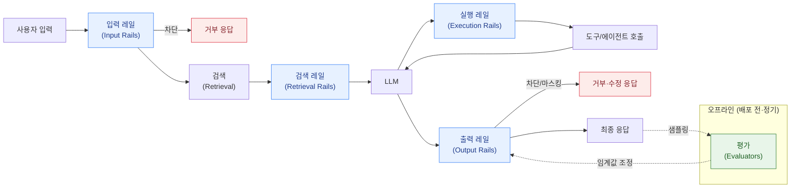

지금까지의 섹션이 "무엇이 공격이고, 무엇이 위험인가"를 다뤘다면, 이 섹션은 **운영 중인 LLM 애플리케이션에서 그 위험을 실제로 막고 측정하는 계층**을 다룹니다. 이것이 **가드레일(Guardrails)** 입니다.

가드레일은 모델 가중치를 바꾸지 않고, **모델 앞뒤에 배치되는 별도의 검사 계층**입니다. 모델 정렬(alignment)이나 안전 파인튜닝이 "모델을 착하게 만드는 일"이라면, 가드레일은 "모델이 나쁘게 굴어도 시스템은 안전하도록 만드는 일"입니다. 모델은 확률적이고 언제든 실수하므로, 운영 시스템에서는 둘 다 필요합니다.

## 가드레일은 어디에 놓이는가

이 5계층 구분은 [NVIDIA NeMo Guardrails](frameworks/)가 정의한 rail 분류(input / dialog / retrieval / execution / output)를 따른 것으로, 프레임워크를 쓰지 않더라도 **"어느 지점에서 무엇을 검사할 것인가"** 를 설계하는 공통 언어로 유용합니다.

## 공격과 가드레일의 매핑

| 위험 | 주로 막는 계층 | 대표 수단 |
|---|---|---|
| [프롬프트 인젝션](../attacks/prompt-injection/) · [탈옥](../attacks/jailbreak/) | 입력 레일 | Prompt Guard 2, Azure Prompt Shields, 휴리스틱 |
| 유해 콘텐츠(혐오·폭력·성적 콘텐츠 등) | 입력 + 출력 레일 | Llama Guard 4, ShieldGemma, Bedrock 콘텐츠 필터 |
| [간접 인젝션](../attacks/prompt-injection/) · [RAG 인덱스 오염](../attacks/data-poisoning/) | 검색 레일 | 출처 신뢰도, 문서 스캔, 청크 위생 |
| PII·기밀 유출 | 출력 레일 | PII 탐지·마스킹, 정규식 + ML 탐지기 |
| [환각(Hallucination)](hallucination/) | 출력 레일 + 오프라인 평가 | 그라운딩 검사, HHEM·Lynx, RAGAS |
| [과도한 권한](../governance/owasp-llm-top10/) | 실행 레일 | 도구 화이트리스트, 인자 검증, 승인 게이트 |


**가드레일은 확률적 방어입니다.** 분류기 기반 가드레일은 오탐(false positive)과 미탐(false negative)을 반드시 냅니다. 따라서 가드레일은 **[안전한 출력 처리](../attacks/prompt-injection/), 최소 권한, 샌드박싱 같은 결정론적 통제를 대체하지 못하고 보완할 뿐입니다.** "Llama Guard를 붙였으니 인젝션은 막았다"는 설계는 위험합니다.


## 이 섹션의 구성


  
  
  
  
  
  
  


## 다른 섹션과의 연결

- [② 공격 기법](../attacks/) — 가드레일이 막아야 할 대상. 공격 메커니즘을 모르면 어떤 레일이 필요한지 판단할 수 없습니다.
- [③ 방어 기법](../defenses/) — 적대적 훈련·차분 프라이버시는 **모델 학습 단계**의 방어입니다. 가드레일은 **추론·운영 단계**의 방어로, 계층이 다릅니다.
- [⑤ 거버넌스](../governance/) — [OWASP LLM Top 10](../governance/owasp-llm-top10/)과 [NIST AI RMF](../governance/nist-ai-rmf/)는 "무엇을 통제해야 하는가"를 정의하고, 가드레일은 그 통제의 구현체입니다. EU AI Act의 투명성·위험관리 요구도 상당 부분 이 계층에서 증거를 남깁니다.
- [⑧ 사례 기술 분석](../incidents/) — 이 섹션의 통제가 **실제 사건에서 어느 단계를 끊었는지**를 사례로 확인합니다. 특히 [계열 A](../incidents/zero-click-exfiltration/)는 "가드레일 4개가 순차적으로 뚫린" 기록이므로, 가드레일을 설계하기 전에 읽어 두면 과신을 피할 수 있습니다.
- [⑥ 레드팀](../red-teaming/) — 레드팀은 가드레일의 구멍을 찾는 활동입니다. **레드팀 결과 → 가드레일 규칙/임계값 갱신 → 재검증**의 순환이 정상적인 운영 형태입니다.
