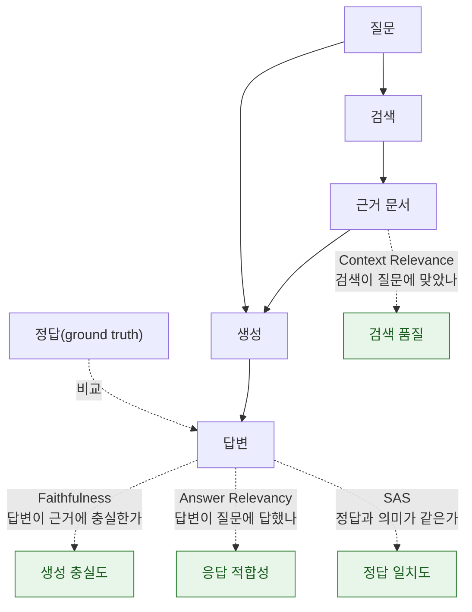

가드레일을 붙였다면 다음 질문은 하나입니다. **"그래서 좋아졌는가?"** 평가자(evaluator)는 이 질문에 숫자로 답하는 장치입니다. 평가 없이 가드레일을 운영하는 것은 로그 없이 방화벽을 운영하는 것과 같습니다 — 뭔가 막고 있다는 느낌만 있고, 무엇을 막았고 무엇을 놓쳤는지는 모릅니다.

평가자는 크게 두 갈래입니다.

| 유형 | 방식 | 장점 | 단점 |
|---|---|---|---|
| **모델 기반(model-based)** | 임베딩·분류기로 점수 계산 | 빠름, 저렴, 결정론적 | 미묘한 의미 차이에 둔감 |
| **LLM 기반(LLM-as-a-Judge)** | LLM에게 판정을 시킴 | 유연, 근거 설명 가능 | 느림, 비용, 심판 모델 자체의 편향 |

## 핵심 지표 네 가지



### Faithfulness (충실도) — LLM-as-a-Judge

답변이 **주어진 근거 문서에서 도출되는가**를 판정합니다. 계산 방식은 대체로 다음과 같습니다.

1. 답변을 개별 주장(claim) 단위로 쪼갠다.
2. 각 주장이 근거 문서에서 추론 가능한지 LLM에게 판정시킨다.
3. `충실도 = 근거로 뒷받침되는 주장 수 / 전체 주장 수`

**정답(ground truth)이 필요 없다**는 것이 실무적으로 결정적입니다. 정답 데이터셋 없이도 **운영 트래픽에 그대로 적용**해 [환각](../hallucination/)을 잡아낼 수 있습니다.


**LLM-as-a-Judge는 그 자체로 신뢰의 이동입니다.** 심판 모델도 환각하고, 자기 계열 모델의 출력을 후하게 평가하는 편향(self-preference bias)이 보고되어 있으며, 프롬프트를 조금만 바꿔도 점수가 흔들립니다. 그래서 실무에서는 **주기적으로 사람이 표본 50~100건을 직접 채점해 심판을 보정(calibration)** 합니다. 심판 점수를 절대값이 아니라 **버전 간 상대 비교 지표**로 쓰는 것이 안전합니다.


### Context Relevance (문맥 관련성)

**검색된 문서가 질문과 관련이 있는가**를 판정합니다. 생성 품질이 나쁠 때 원인이 "검색"인지 "생성"인지를 가르는 핵심 진단 지표입니다.

- Context Relevance 낮음 + Faithfulness 높음 → **검색 문제**. 청킹·임베딩·리랭킹을 손봐야 합니다.
- Context Relevance 높음 + Faithfulness 낮음 → **생성 문제**. 프롬프트·모델·[환각 탐지](../hallucination/)를 손봐야 합니다.

### SAS (Semantic Answer Similarity)

예측 답변과 정답의 **의미적 유사도**를 크로스 인코더로 계산하는 **모델 기반** 지표입니다. 단어가 하나도 겹치지 않아도 뜻이 같으면 높은 점수가 나오므로, 문자열 일치(Exact Match)나 F1보다 실제 품질과 상관이 높습니다.

정답 데이터셋이 필요하므로 **운영 모니터링이 아니라 배포 전 회귀 테스트**에 씁니다. LLM 호출이 없어 대규모 데이터셋에도 저렴하게 돌릴 수 있습니다.

### RAGAS

[Ragas](https://docs.ragas.io/)는 RAG 파이프라인 평가에 특화된 오픈소스 프레임워크로, 위 지표들을 묶어 제공합니다.

| 지표 | 측정 대상 | 정답 필요 |
|---|---|---|
| `faithfulness` | 답변 ↔ 근거의 일치 | 불필요 |
| `answer_relevancy` | 답변 ↔ 질문의 적합성 | 불필요 |
| `context_precision` | 검색된 문서 중 실제로 유용한 비율 | 경우에 따라 |
| `context_recall` | 필요한 정보가 모두 검색됐는가 | 필요 |
| `factual_correctness` | 답변 ↔ 정답의 사실 일치 | 필요 |

```python
from ragas import evaluate
from ragas.metrics import faithfulness, answer_relevancy, context_precision, context_recall
from datasets import Dataset

data = Dataset.from_dict({
    "question":   ["환불 기한은 며칠인가요?"],
    "answer":     ["구매일로부터 14일 이내에 환불이 가능합니다."],
    "contexts":   [["환불은 구매일로부터 14일 이내에 신청할 수 있습니다."]],
    "ground_truth": ["14일"],
})

result = evaluate(data, metrics=[faithfulness, answer_relevancy, context_precision, context_recall])
print(result)
```


정답이 필요 없는 `faithfulness`·`answer_relevancy`는 **운영 트래픽 샘플링**에, 정답이 필요한 `context_recall`·`factual_correctness`는 **CI 회귀 테스트**에 배치하는 것이 일반적인 분업입니다.


## Haystack의 내장 평가자

[Haystack](../frameworks/)은 이 지표들을 파이프라인 컴포넌트로 제공하므로, 평가를 별도 스크립트가 아니라 파이프라인의 일부로 조립할 수 있습니다.

| 컴포넌트 | 유형 | 측정 |
|---|---|---|
| `FaithfulnessEvaluator` | LLM 기반 | 답변이 근거에서 추론 가능한가 |
| `ContextRelevanceEvaluator` | LLM 기반 | 근거가 질문과 관련 있는가 |
| `SASEvaluator` | 모델 기반 | 예측 답변과 정답의 의미 유사도 |
| `AnswerExactMatchEvaluator` | 모델 기반 | 문자 단위 완전 일치 |
| `DocumentRecallEvaluator` / `DocumentMAPEvaluator` / `DocumentMRREvaluator` / `DocumentNDCGEvaluator` | 모델 기반 | 검색 단계의 재현율·정밀도·랭킹 품질 |
| `LLMEvaluator` | LLM 기반 | 직접 작성한 지시로 임의 기준 평가 |
| `RagasEvaluator` | LLM 기반 | Ragas 지표를 Haystack 안에서 호출 |

```python
from haystack.components.evaluators import FaithfulnessEvaluator, SASEvaluator

faith = FaithfulnessEvaluator()
print(faith.run(
    questions=["환불 기한은?"],
    contexts=[["환불은 구매일로부터 14일 이내."]],
    predicted_answers=["14일 이내에 가능합니다."],
))

sas = SASEvaluator(model="sentence-transformers/paraphrase-multilingual-mpnet-base-v2")
sas.warm_up()
print(sas.run(ground_truth_answers=["14일"], predicted_answers=["이 주일"]))
```


SAS의 기본 모델은 영어 중심입니다. 한국어 데이터셋을 평가할 때는 위 예시처럼 **다국어 문장 임베딩 모델을 명시적으로 지정**하지 않으면 점수가 무의미해집니다.


## 평가를 운영에 붙이는 방법

| 시점 | 무엇을 | 어떻게 |
|---|---|---|
| **CI (PR마다)** | 회귀 방지 | 고정 데이터셋 50~200건에 SAS·context recall, 임계값 미달 시 빌드 실패 |
| **배포 전** | 변경 영향 | 프롬프트·모델·청킹 변경 전후를 동일 데이터셋으로 A/B 비교 |
| **운영 중 (상시)** | 이상 감지 | 트래픽 1~5% 샘플링에 faithfulness·answer relevancy, 이동평균 하락 시 알림 |
| **주기적 (주간)** | 심판 보정 | 사람이 무작위 50~100건을 직접 채점해 LLM 심판과의 상관을 확인 |
| **레드팀 이후** | 가드레일 갱신 | 레드팀에서 통과된 공격을 평가 데이터셋에 영구 추가 |

평가 데이터셋은 한 번 만들고 끝나는 것이 아니라, **[레드팀](../../red-teaming/llm-red-teaming/)에서 뚫린 사례와 운영에서 발견된 실패를 계속 흡수하며 자라는 자산**입니다. 이 데이터셋의 축적 여부가 조직의 AI 보안 성숙도를 가르는 실질적인 차이입니다.

## 더 살펴보기

- [환각과 탐지](../hallucination/) — 런타임 탐지와 오프라인 평가의 역할 구분
- [가드레일 프레임워크](../frameworks/) — Haystack 파이프라인에 평가자 조립하기
- [Lab 11: 가드레일 파이프라인 실습](/labs/lab11-guardrails-pipeline/)
