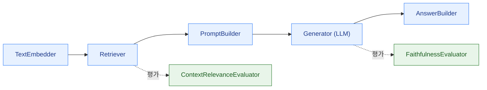

가드레일은 직접 만들 수도 있지만(입력 앞에 분류기 하나 붙이는 것도 가드레일입니다), 규칙이 늘어나면 **어디에 무엇이 걸려 있는지**를 관리하는 일이 곧 문제가 됩니다. 프레임워크는 이 관리 문제를 해결합니다.

성격이 다른 세 가지를 봅니다.

| | 역할 | 핵심 추상화 | 어울리는 상황 |
|---|---|---|---|
| **Haystack** | RAG·에이전트 **파이프라인** 프레임워크 | Component + Pipeline | 앱 자체를 만들면서 평가·안전 컴포넌트를 같은 그래프에 조립 |
| **Guardrails AI** | **검증(validation)** 라이브러리 | Guard + Validator | 기존 앱의 입출력에 검증 규칙을 얇게 덧붙이기 |
| **NeMo Guardrails** | **대화 정책** 툴킷 | Rails + Colang | 다중 턴 대화 흐름 자체를 선언적으로 통제 |

셋은 경쟁 관계가 아니라 계층이 다릅니다. Haystack 파이프라인 안에서 NeMo rail을 호출하는 구성도 가능합니다.

## Haystack

deepset의 오픈소스 프레임워크로, **타입이 명시된 컴포넌트를 연결한 방향 그래프**로 LLM 애플리케이션을 표현합니다.



컴포넌트는 `@component` 데코레이터와 `@component.output_types(...)`로 입출력 타입을 선언하는 파이썬 클래스입니다. 파이프라인은 연결 시점에 **타입 호환성을 검사**하므로, 잘못 연결하면 실행 전에 실패합니다. 루프(cycle)를 허용하므로 자기 교정(self-correcting) 흐름이나 에이전트 루프도 같은 원시 개념으로 표현됩니다.

```python
from haystack import Pipeline
from haystack.components.builders import PromptBuilder

pipe = Pipeline()
pipe.add_component("embedder", text_embedder)
pipe.add_component("retriever", retriever)
pipe.add_component("prompt", PromptBuilder(template=TEMPLATE))
pipe.add_component("llm", generator)

pipe.connect("embedder.embedding", "retriever.query_embedding")
pipe.connect("retriever.documents", "prompt.documents")
pipe.connect("prompt.prompt", "llm.prompt")

result = pipe.run({"embedder": {"text": question}, "prompt": {"question": question}})
```

가드레일 관점에서 Haystack의 이점은 **[평가자](../evaluators/)가 일급 컴포넌트**라는 점입니다. 평가를 별도 스크립트로 분리하지 않고 파이프라인 안에 두면, 평가 조건이 실제 실행 경로와 어긋나는 흔한 사고를 피할 수 있습니다.


**버전 주의.** Haystack은 2026년 7월 **3.0**을 공개했습니다. Agent에 훅(hooks)과 skills가 들어가고, `Pipeline`과 `AsyncPipeline`이 하나로 합쳐져 `run_async`로 통합됐으며, 레거시 Generator가 제거되고 30여 개 컴포넌트가 별도 통합 패키지로 분리되어 코어가 가벼워졌습니다. 2.x → 3.x는 재작성이 아닌 연장선이라 대부분 임포트 경로 수정 수준이지만, 인터넷의 2.x 기준 예제가 그대로 돌아가지 않을 수 있습니다. 2.31은 2026년 10월 말까지 보안 패치만 제공될 예정이므로 신규 구축은 3.x 기준으로 시작하세요.


## Guardrails AI

파이썬(및 자바스크립트) 라이브러리로, **Guard** 객체에 **Validator**를 조합해 LLM의 입출력을 검증합니다.

- **Guard** — 입력 또는 출력을 가로채는 검증 파이프라인
- **Validator** — 하나의 위험을 측정하는 단위 (독성, PII, 경쟁사 언급, 정규식 일치, 환각 등)
- **OnFailAction** — 검증 실패 시 동작: `EXCEPTION`(예외 발생), `FIX`(수정), `FILTER`(제거), `REASK`(재질의), `NOOP`(통과 + 기록)

```python
from guardrails import Guard, OnFailAction
from guardrails.hub import ToxicLanguage, DetectPII

guard = Guard().use_many(
    ToxicLanguage(threshold=0.5, on_fail=OnFailAction.EXCEPTION),
    DetectPII(pii_entities=["EMAIL_ADDRESS", "PHONE_NUMBER"], on_fail=OnFailAction.FIX),
)

result = guard.validate(llm_output)
print(result.validated_output)   # PII가 마스킹된 출력
```

Pydantic 모델을 함께 넘겨 **구조화 출력을 강제**하고, 스키마를 벗어나면 자동으로 재질의하게 만들 수도 있습니다. 이 "실패 시 재질의" 패턴이 Guardrails AI의 특징적인 부분입니다.


**2026년의 큰 변화가 있습니다.** Guardrails AI는 Validator를 **표준 PyPI 패키지로 `pip` 직접 설치**하는 방식으로 전환하고, **호스팅형 원격 추론(hosted remote inferencing)을 2026년 8월 25일자로 종료**했습니다. 즉 예전 자료에 나오는 `guardrails hub install ...` 흐름과 원격 추론 엔드포인트에 의존하는 구성은 더 이상 그대로 동작하지 않으며, 검증 모델을 **자체 인프라에서 실행**하는 것을 전제로 설계해야 합니다. 용량 산정 시 이 추론 비용을 빠뜨리지 마세요.


## NVIDIA NeMo Guardrails

Apache 2.0 라이선스의 오픈소스 툴킷으로, 다른 둘과 구별되는 지점은 **다중 턴 대화 흐름 자체를 선언적으로 통제**한다는 것입니다. 단발 입출력 필터링을 넘어 "이 주제로는 대화를 진행하지 않는다"를 정책으로 기술할 수 있습니다.

### 5가지 rail

| Rail | 시점 | 예 |
|---|---|---|
| **Input rails** | 사용자 메시지 수신 직후 | 인젝션 탐지, 유해성 분류, PII 마스킹 |
| **Dialog rails** | 의도 판정 후 흐름 결정 | 금지 주제 회피, 정해진 답변으로 유도 |
| **Retrieval rails** | 검색 결과에 적용 | 신뢰도 낮은 청크 제거, 숨은 지시문 탐지 |
| **Execution rails** | 도구/액션 호출 전후 | 인자 검증, 위험한 호출 차단 |
| **Output rails** | 응답 반환 직전 | 사실성 검사, 민감정보 제거 |

이 5계층 구분은 프레임워크를 쓰지 않더라도 **가드레일 설계의 표준 어휘**로 그대로 쓸 만합니다.

### Colang

대화 흐름을 기술하는 도메인 특화 언어입니다.

```colang
define user ask about competitor
  "경쟁사 제품이 더 낫나요?"
  "타사 제품과 비교해주세요"

define bot refuse competitor comparison
  "저는 저희 제품에 대한 안내만 도와드릴 수 있습니다."

define flow
  user ask about competitor
  bot refuse competitor comparison
```

```yaml
# config.yml — rail 구성
models:
  - type: main
    engine: openai
    model: gpt-4o
rails:
  input:
    flows:
      - self check input
      - content safety check input $model=content_safety
  output:
    flows:
      - self check output
```


Colang은 **1.0과 2.0이 공존**하며 기본값은 1.0입니다. 2.0은 언어와 런타임을 전면 개편해 병렬 플로우와 이벤트 스트림 패턴 매칭을 지원하지만, 문법이 달라 예제를 섞어 쓰면 동작하지 않습니다. 어느 버전 기준의 자료인지 먼저 확인하세요.

최신 계열인 **v0.24.x**에서는 입출력 전용 경량 엔진(IORails), 스트리밍 출력 rail, OpenTelemetry 추적, Hugging Face 분류기 rail, `/v1/checks` 형태의 독립 검사 엔드포인트 등이 추가되어 **가드레일을 애플리케이션과 분리된 서비스로 운영**하기가 쉬워졌습니다.


NeMo Guardrails에는 Llama Guard, ShieldGemma, `Llama-3.1-NemoGuard-8B-ContentSafety`(Aegis) 같은 [콘텐츠 안전 모델](../input-guardrails/)이 rail로 내장되어 있어, 모델을 직접 로드하지 않고 설정만으로 붙일 수 있습니다.

## 무엇을 고를 것인가

- **RAG 앱을 새로 만든다** → Haystack으로 파이프라인을 짜고, 평가자를 처음부터 같은 그래프에 넣습니다.
- **이미 돌아가는 앱에 통제를 덧붙인다** → Guardrails AI로 입출력 Guard만 얇게 감쌉니다.
- **대화 정책과 금지 주제가 복잡하다** → NeMo Guardrails의 dialog rails가 유일하게 이 층위를 다룹니다.
- **AWS 위에서 관리형으로 간다** → [Bedrock Guardrails](../bedrock-guardrails/).


프레임워크를 도입해도 **가드레일의 품질은 여전히 그 안에 넣은 모델·규칙·임계값이 결정합니다.** 프레임워크는 관리를 쉽게 할 뿐 방어력을 주지 않습니다. 도입 후에도 [레드팀](../../red-teaming/llm-red-teaming/)으로 실제 우회 가능성을 반드시 확인하세요.


## 더 살펴보기

- [입력 가드레일](../input-guardrails/) · [평가자](../evaluators/)
- [AWS Bedrock Guardrails](../bedrock-guardrails/) — 관리형 대안
- [LLM 레드티밍 도구](/tools/llm-redteam-tools/)
