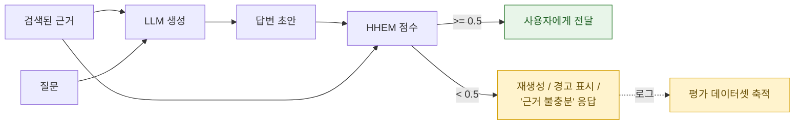

환각(hallucination)은 LLM이 **사실이 아니거나 근거가 없는 내용을, 사실인 것처럼 자신 있게 생성하는 현상**입니다. 언어 모델은 "다음 토큰의 확률 분포"를 학습한 것이지 "사실 여부"를 학습한 것이 아니므로, 환각은 버그가 아니라 구조적 특성입니다. 따라서 목표는 제거가 아니라 **탐지·억제·측정**입니다.

환각을 보안 지식베이스에서 다루는 이유는, 이것이 단순한 품질 문제가 아니라 **무결성(integrity) 위험**이기 때문입니다. [OWASP LLM Top 10](../../governance/owasp-llm-top10/)의 오정보(Misinformation) 항목과 [NIST AI RMF](../../governance/nist-ai-rmf/)의 신뢰성 요구가 이 지점을 직접 겨냥합니다. 존재하지 않는 라이브러리 이름을 만들어내면 **패키지 스쿼팅([공급망 공격](../../infrastructure/supply-chain-risk/))** 의 입구가 되고, 존재하지 않는 사내 규정을 만들어내면 규제 리스크가 됩니다.

## 유형 구분

| 유형 | 정의 | 탐지 가능성 |
|---|---|---|
| **비충실성(faithfulness) 환각** | 주어진 근거 문서와 답변이 어긋남 | **높음** — 근거가 있으므로 자동 판정 가능 |
| **사실성(factuality) 환각** | 근거 없이, 세상의 사실과 어긋남 | 낮음 — 외부 지식 검증이 필요 |
| **지시 위반** | 요청한 형식·범위를 벗어남 | 높음 — 스키마·규칙 검사 |
| **인용 환각** | 출처를 그럴듯하게 지어냄 | 중간 — 출처 존재 여부 대조 |


**RAG 환경에서는 대부분의 실무 문제가 비충실성 환각입니다.** 검색된 문서가 근거로 주어져 있으므로 "답변의 각 주장이 이 근거에서 도출되는가"를 기계적으로 판정할 수 있습니다. 이것이 [평가자(Evaluators)](../evaluators/)의 Faithfulness 지표와 아래 탐지 모델들이 하는 일입니다.


## 오픈소스 탐지 모델

### Vectara HHEM (Hughes Hallucination Evaluation Model)

`vectara/hallucination_evaluation_model` (HHEM-2.1-Open)은 **(근거, 답변) 쌍을 입력받아 0~1의 사실 일치 점수를 내는 크로스 인코더**입니다. LLM을 심판으로 호출하지 않으므로 저렴하고 결정론적입니다.

- 32비트 정밀도에서 **600MB 미만 메모리**로 동작하고, 일반적인 x86 CPU에서 2k 토큰 입력에 **약 1.5초** 수준 — GPU 없이 인라인 배치가 현실적입니다.
- Vectara는 이 모델로 [LLM 환각 리더보드](https://github.com/vectara/hallucination-leaderboard)를 운영합니다.

```python
from transformers import AutoModelForSequenceClassification

model = AutoModelForSequenceClassification.from_pretrained(
    "vectara/hallucination_evaluation_model", trust_remote_code=True
)

pairs = [
    ("환불은 구매일로부터 14일 이내에 가능합니다.", "환불 기한은 14일입니다."),   # 일치 → 높은 점수
    ("환불은 구매일로부터 14일 이내에 가능합니다.", "환불 기한은 30일입니다."),   # 모순 → 낮은 점수
]
print(model.predict(pairs))   # 근거와의 일관성 점수
```

### Patronus Lynx

`PatronusAI/Lynx` 계열(8B·70B)은 **RAG 환각 판정에 특화된 오픈 웨이트 LLM 심판 모델**입니다. 근거·질문·답변을 받아 판정과 **판정 근거(reasoning)** 를 함께 출력합니다. 함께 공개된 `HaluBench`는 환각 탐지기의 성능을 비교할 때 쓰는 벤치마크입니다.

HHEM이 "빠르고 싼 점수", Lynx가 "느리지만 설명이 붙는 판정"이라고 보면 역할이 갈립니다.

### 선택 기준

| 상황 | 권장 |
|---|---|
| 모든 응답에 인라인 검사 | HHEM-2.1-Open (CPU 가능, 저지연) |
| 샘플링한 트래픽의 정밀 분석 | Lynx, 또는 LLM-as-a-Judge |
| 관리형 인프라 선호 | [Bedrock Guardrails의 Contextual Grounding / Automated Reasoning 검사](../bedrock-guardrails/) |
| 배포 전 회귀 테스트 | [RAGAS Faithfulness](../evaluators/) |

## 탐지 이전에 줄이는 방법

탐지는 마지막 방어선입니다. 그 전에 발생 자체를 줄이는 수단이 더 저렴합니다.

1. **검색 품질 개선** — 잘못된 근거를 주면 아무리 좋은 모델도 잘못 답합니다. [Context Relevance](../evaluators/)로 검색 단계를 먼저 측정하세요.
2. **"모른다"를 허용** — 시스템 프롬프트에서 근거 부족 시 답변 거부를 명시하고, 그 응답을 실패가 아닌 정상 동작으로 취급.
3. **유사도 임계값** — 관련성이 낮은 문서는 아예 프롬프트에 넣지 않기.
4. **인용 강제** — 문장 단위로 출처 ID를 붙이게 하고, 존재하지 않는 ID면 응답을 거부.
5. **구조화 출력** — 자유 서술 대신 스키마를 강제해 지어낼 여지를 줄이기.

## 파이프라인에 붙이기




**임계값을 재생성 루프에 그대로 연결하면 비용이 폭증합니다.** "점수가 낮으면 다시 생성"을 무한정 반복하면 지연과 토큰 비용이 예측 불가능해집니다. 재시도 횟수를 1회로 제한하고, 실패 시에는 재생성 대신 **"근거가 충분하지 않습니다"로 정직하게 응답**하는 편이 대부분의 업무 맥락에서 낫습니다.


## 더 살펴보기

- [평가자(Evaluators)](../evaluators/) — Faithfulness를 오프라인 지표로 측정하기
- [RAG와 벡터 스토어](../rag-vector-store/) — 검색 품질이 환각의 1차 원인
- [LLM 레드티밍 도구](/tools/llm-redteam-tools/) — garak의 환각 probe, Giskard의 자동 스캔
