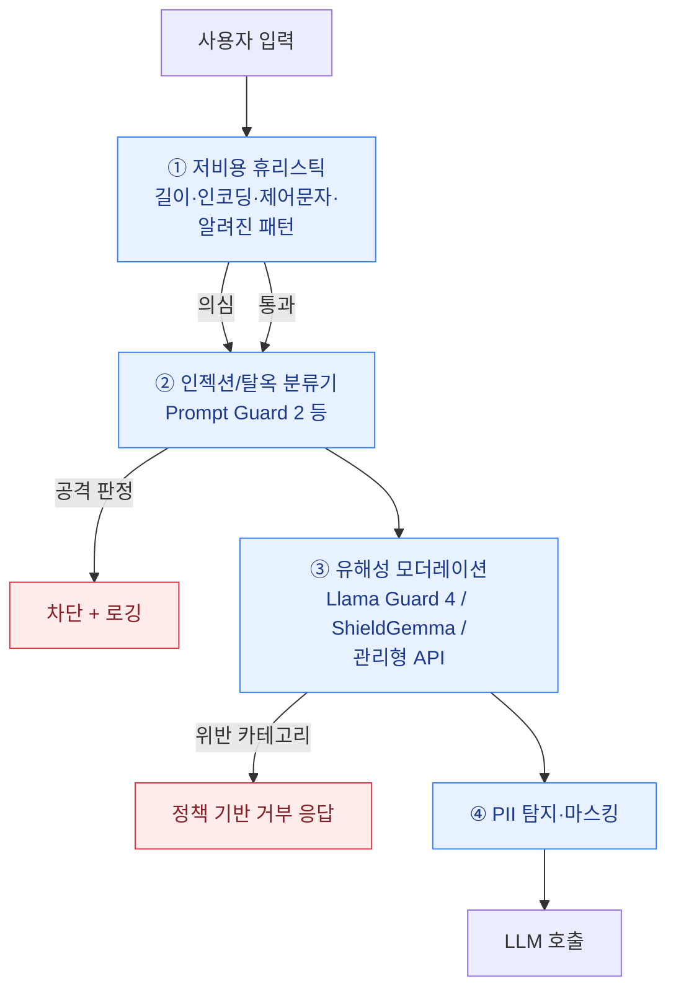

입력 가드레일은 사용자의 입력이 LLM에 도달하기 **전에** 검사하는 계층입니다. 가장 앞단에 있으므로 비용이 가장 싸고(모델 호출 전에 차단), 오탐이 나면 정상 사용자를 막아버리므로 임계값 조정이 가장 예민한 계층이기도 합니다.

입력 가드레일이 다루는 위험은 성격이 다른 두 가지입니다.

1. **공격성 입력** — [프롬프트 인젝션](../../attacks/prompt-injection/), [탈옥](../../attacks/jailbreak/) 시도. *시스템을 지키는* 문제.
2. **유해성 입력** — 혐오, 폭력, 성적 콘텐츠, 자해, 불법 행위 요청 등. *사람과 정책을 지키는* 문제.

둘은 탐지 기법과 대응 방식이 다르므로 하나의 분류기로 뭉뚱그리지 않는 편이 좋습니다.



## ① 휴리스틱 계층

모델을 부르기 전에 거를 수 있는 것부터 거릅니다. 정확도는 낮지만 지연이 사실상 0이고, 자동화된 대량 시도를 상당수 걷어냅니다.

- 비정상적 입력 길이, 반복 토큰, 극단적 엔트로피
- Base64 · ROT13 · 유니코드 태그 문자(`U+E0000` 블록) · 제로폭 문자 등 **난독화 신호**
- "ignore previous instructions", "you are now DAN" 류의 알려진 문자열 (변형에 매우 취약하므로 **단독 방어로는 무의미**)
- 시스템 프롬프트 유출을 노리는 정형 질의 패턴


문자열 블랙리스트는 **탐지 신호**로만 쓰고 차단 근거로 삼지 마세요. 공격자는 띄어쓰기·동의어·번역·인코딩만 바꿔도 우회합니다. 블랙리스트에 의존하는 방어는 [레드팀](../../red-teaming/llm-red-teaming/)에서 가장 먼저 무너지는 항목입니다.


## ② 인젝션·탈옥 분류기

전용 소형 분류 모델을 쓰는 것이 현재의 표준적 접근입니다.

| 모델 | 형태 | 특징 |
|---|---|---|
| **Llama Prompt Guard 2** (86M / 22M) | 오픈 웨이트 분류기 | Meta가 2025년 4월 Llama 4와 함께 공개. 프롬프트 인젝션·탈옥 탐지 전용. 22M 버전은 지연·연산을 크게 낮춘 경량판이라 모든 요청에 인라인으로 붙이기 적합 |
| **Azure AI Content Safety — Prompt Shields** | 관리형 API | 사용자 입력의 탈옥 시도와 **문서에 숨은 간접 인젝션**을 분리해 탐지 |
| **Amazon Bedrock Guardrails — Prompt Attack 필터** | 관리형 | 콘텐츠 필터의 한 카테고리로 제공 → [Bedrock 편](../bedrock-guardrails/) |

```python
# Prompt Guard 2를 입력 앞단에 붙이는 최소 형태
from transformers import pipeline

# 86M: 정확도 우선 / 22M: 지연·비용 우선
clf = pipeline("text-classification", model="meta-llama/Llama-Prompt-Guard-2-86M")

def input_gate(user_text: str, threshold: float = 0.9) -> bool:
    r = clf(user_text)[0]
    # 라벨 체계는 모델 카드 기준으로 확인할 것 (버전에 따라 다름)
    return not (r["label"] == "LABEL_1" and r["score"] >= threshold)
```


**임계값은 반드시 자체 데이터로 정하세요.** 모델 카드의 기본값은 벤치마크 분포 기준입니다. 사내 정상 질의 1,000건과 [레드팀](../../red-teaming/llm-red-teaming/)에서 수집한 공격 질의를 함께 통과시켜 **오탐률을 먼저 고정**하고, 그 제약 안에서 탐지율을 최대화하는 것이 실무 순서입니다.


## ③ 유해성 모더레이션

혐오·폭력·성적 콘텐츠 등 **정책 위반 카테고리**를 판정합니다. 인젝션 탐지와 달리, 여기서는 "무엇이 위반인가"를 조직이 정의해야 하므로 **카테고리 체계(taxonomy)** 가 먼저입니다.

| 모델 / 서비스 | 특징 |
|---|---|
| **Llama Guard 4** (12B) | Meta의 최신 세이프가드 모델. 초기 융합(early-fusion) 구조의 **네이티브 멀티모달** 분류기로 텍스트와 이미지를 함께 판정. Llama 4 계열과 함께 쓰도록 설계됨. 입력·출력 양방향에 쓸 수 있고, 프롬프트에 카테고리 정의를 넣어 **정책을 커스터마이즈**할 수 있음 |
| **ShieldGemma / ShieldGemma 2** | Google. 1세대는 Gemma 2 기반(2B/9B/27B, 4개 위해 카테고리), ShieldGemma 2는 Gemma 3 기반 4B로 **이미지 안전성 분류**를 추가 |
| **Llama 3.1 NemoGuard 8B ContentSafety / Aegis** | NVIDIA. [NeMo Guardrails](../frameworks/)에 기본 통합되어 rail로 바로 호출 가능 |
| **관리형 모더레이션 API** | OpenAI Moderation, Azure AI Content Safety, Bedrock 콘텐츠 필터 — 운영 부담이 적고 다국어 커버리지가 넓음 |

```python
# Llama Guard 4: 카테고리 정의를 프롬프트로 주입해 정책을 조직에 맞게 조정
from transformers import AutoTokenizer, AutoModelForCausalLM

tok = AutoTokenizer.from_pretrained("meta-llama/Llama-Guard-4-12B")
model = AutoModelForCausalLM.from_pretrained("meta-llama/Llama-Guard-4-12B", device_map="auto")

chat = [{"role": "user", "content": user_text}]
ids = tok.apply_chat_template(chat, return_tensors="pt").to(model.device)
out = model.generate(ids, max_new_tokens=20)
verdict = tok.decode(out[0][ids.shape[-1]:], skip_special_tokens=True)
# "safe" 또는 "unsafe\nS1" 형태로 위반 카테고리 코드가 반환됨
```

### 한국어에서의 주의점

공개 세이프가드 모델의 학습 데이터는 영어 비중이 압도적입니다. 한국어 입력에 대해서는 **탐지율이 눈에 띄게 떨어지거나, 반대로 특정 표현을 과잉 차단**하는 경우가 흔합니다. 도입 전 한국어 샘플로 별도 검증하고, 필요하면 다국어 커버리지를 명시한 관리형 서비스(예: Bedrock 콘텐츠 필터의 Standard 티어는 60개 언어 지원을 명시)를 함께 고려하세요.

## ④ 위반 시 무엇을 할 것인가

차단만이 답은 아닙니다. 대응 방식은 위험 유형별로 다르게 설계합니다.

| 대응 | 적합한 상황 |
|---|---|
| **차단(block)** | 명백한 공격, 고위험 카테고리 |
| **마스킹·수정(anonymize)** | 입력에 PII가 섞였지만 질의 자체는 정상 |
| **재질의(reask)** | 경계선 입력 — 사용자에게 다시 묻기 |
| **통과 + 플래그** | 오탐 비용이 큰 경우, 차단하지 않고 로그·모니터링만 |
| **단계적 제재** | 동일 사용자의 반복 시도에 대해 레이트 리밋 → 일시 차단 |


**거부 응답 자체가 정보를 흘립니다.** "해당 요청은 시스템 프롬프트 보호 정책에 의해 차단되었습니다" 같은 메시지는 공격자에게 어떤 가드레일이 걸려 있는지 알려줍니다. 사용자에게는 일반화된 메시지를 주고, 상세 사유는 **로그에만** 남기세요.


## 운영 체크리스트

- [ ] 인젝션 탐지와 유해성 모더레이션을 분리된 단계로 구성했는가
- [ ] 임계값을 자체 데이터(정상 질의 + 레드팀 수집 공격)로 튜닝했는가
- [ ] 한국어 입력에 대해 별도 검증했는가
- [ ] 가드레일 판정 결과(입력 해시, 카테고리, 점수, 조치)를 감사 로그로 남기는가
- [ ] 가드레일 자체의 장애 시 동작을 정의했는가 (**fail-closed** 원칙 — 분류기 타임아웃 시 통과시키면 가드레일이 없는 것과 같음)
- [ ] 거부 메시지가 내부 정책 구조를 노출하지 않는가

## 더 살펴보기

- [프롬프트 인젝션](../../attacks/prompt-injection/) · [탈옥](../../attacks/jailbreak/) — 막아야 할 대상의 메커니즘
- [LLM 레드티밍 도구](/tools/llm-redteam-tools/) — garak 등으로 가드레일을 실제로 뚫어 보기
- [Lab 11: 가드레일 파이프라인 실습](/labs/lab11-guardrails-pipeline/)
