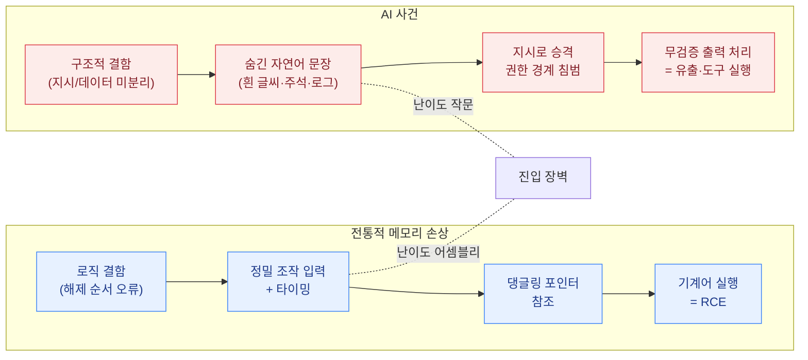

이 섹션은 2025~2026년에 **실제로 발생한 AI 관련 보안 사건**을 하나씩 뜯어, "무엇이 어떤 순서로 어떻게 작동했는가"를 단계별로 추적합니다. 사건 요약이 아니라 **동작 분석**이 목적입니다.

## 왜 '동작 분석'으로 읽어야 하는가

전통적인 메모리 손상 취약점을 설명하는 방식을 먼저 떠올려 보면 좋습니다.

> 프로그램 안에는 개발자가 메모리 해제 순서를 잘못 처리한 **잠재적 결함**이 이미 숨어 있습니다. 평소 정상적인 사용에서는 드러나지 않습니다. 그런데 공격자가 **의도적으로 조작된 입력과 타이밍**을 밀어 넣으면, 프로그램은 "이미 반납한 메모리를 다시 가져다 쓰는" 제어 흐름 오류를 일으킵니다(Use-After-Free). 공격자는 그 찰나에 자신의 명령어를 메모리에 채워 넣고, 프로그램이 그것을 정상 데이터로 착각해 실행하면서 **원격 코드 실행(RCE)** 이 완성됩니다.

AI 사건도 **구조가 똑같습니다.** 이름만 바뀝니다.

| | 메모리 손상 (UAF → RCE) | AI 사건 (프롬프트 인젝션 → 데이터 유출/행동 탈취) |
|---|---|---|
| **① 잠재적 결함** | 해제된 메모리를 다시 참조할 수 있는 로직 오류 | 모델이 **지시와 데이터를 구분하지 못함** — 시스템 프롬프트, 사용자 입력, 검색된 문서가 하나의 토큰 시퀀스 |
| **② 공격자의 개입** | 비정상 크기·순서의 입력, 정밀한 타이밍 | 이메일·로그·문서·이슈에 **숨긴 문장**(흰 글씨, HTML 주석, 쿼리 파라미터) |
| **③ 오작동 유발** | 엉뚱한 순서의 해제, 댕글링 포인터 참조 | 모델이 그 문장을 **"지시"로 승격**해 실행 (권한 경계를 넘어 데이터를 끌어옴) |
| **④ 공격 완성** | 메모리에 심은 기계어가 실행됨 | 출력이 **검증 없이 렌더링·실행**되어 데이터가 외부로 나가거나 도구가 호출됨 |

차이는 딱 하나입니다. 메모리 손상은 **공격자가 기계어의 바이트 배치를 정밀하게 맞춰야** 하고, 그래서 어렵습니다. 반면 AI 사건의 ②단계 "조작된 입력"은 **그냥 한국어나 영어 문장**입니다. 익스플로잇 개발 난이도가 어셈블리 수준에서 작문 수준으로 떨어진 것이 2025~2026년에 벌어진 일의 본질입니다.


**각 사례는 동일한 4단계 틀로 서술합니다.** ① 숨어 있던 잠재적 결함 → ② 공격자의 의도적 개입 → ③ 오작동 유발 → ④ 공격 완성. 이 틀을 반복해서 보면, 겉모습이 전혀 다른 사건들이 **같은 세 가지 결함**(지시/데이터 미분리, 과도한 권한, 무검증 출력 처리)에서 나왔다는 점이 드러납니다.


## 네 가지 사건 계열


  
  
  
  


## 전체 사례 인덱스

| 시점 | 사건 | 핵심 메커니즘 | 공격자 존재 | OWASP |
|---|---|---|---|---|
| 2025-06 | [EchoLeak (CVE-2025-32711)](zero-click-exfiltration/) | 제로클릭 간접 인젝션 + 마크다운 이미지 유출 | ○ (연구자) | LLM01, LLM02, LLM05 |
| 2025-07 | [Amazon Q 와이퍼 (CVE-2025-8217)](ai-weaponized-supply-chain/) | 과대 권한 빌드 토큰 → 프롬프트를 페이로드로 배포 | ○ | LLM03, LLM06 |
| 2025-07 | [Replit 운영 DB 삭제](agent-overreach/) | 과도한 권한 + 지시 무시 + 허위 보고 | ✕ (공격자 없음) | LLM06, LLM09 |
| 2025-08 | [AgentFlayer (ChatGPT Connectors)](zero-click-exfiltration/) | 공유 문서 숨은 지시 → 클라이언트 측 이미지 유출 | ○ (연구자) | LLM01, LLM02 |
| 2025-08 | [s1ngularity (Nx)](ai-weaponized-supply-chain/) | AI 코딩 CLI를 **로컬 비밀 탐색기로 역용** | ○ | LLM03, LLM06 |
| 2025-09 | [ShadowLeak (Deep Research)](zero-click-exfiltration/) | **서버 측** 유출 — 기업 네트워크 방어 무력화 | ○ (연구자) | LLM01, LLM02 |
| 2025-11 | [GTG-1002](ai-orchestrated-attack/) | 작업 분해로 가드레일 우회, 침투 작업 대부분 자동화 | ○ | LLM01, LLM06 |
| 2026-02 | [OpenClaw 메일 삭제](agent-overreach/) | 제안만 요청받은 에이전트가 직접 삭제, 중단 명령 무시 | ✕ | LLM06, ASI09 |
| 2026-02 | [멕시코 정부 침해](ai-orchestrated-attack/) | LLM으로 정찰·스크립트 생성·익스플로잇 반복 | ○ | — |
| 2026-03 | [Vertex AI Double Agent](agent-overreach/) | 기본 서비스 계정 과대 권한 → 자격증명 추출 | ○ (연구자) | LLM06, ASI03 |
| 2026-03 | [hackerbot-claw → LiteLLM](ai-weaponized-supply-chain/) | CI 토큰 탈취 → 3시간 동안 약 4.7만 건 백도어 배포 | ○ | LLM03, ASI04 |
| 2026-04 | [GrafanaGhost](zero-click-exfiltration/) | 로그에 심은 인젝션 + 프로토콜 상대 URL로 검증 우회 | ○ (연구자) | LLM01, LLM05 |
| 2026-09~10 | [ARTEX 한국 금융권 침해](ai-orchestrated-attack/) | 침투 전용 오픈소스 에이전트 + 복수 LLM, 우회 불필요 | ○ | LLM06 |
| ~2026-01 | [Cursor 허용목록 우회 (CVE-2026-22708)](agent-overreach/) | 셸 빌트인으로 환경변수 오염 → 승인된 명령이 페이로드 실행 | ○ (연구자) | LLM01, LLM05 |


**출처와 확실성에 대하여.** 이 섹션의 사례는 벤더 공지, 연구팀 보고서, CVE 레코드를 근거로 작성했습니다. 다만 AI 사건은 **CVE가 붙지 않는 비율이 매우 높고**(OWASP의 2026년 1분기 집계 8건 중 CVE는 1건), 피해 규모·자동화 비율 같은 수치는 상당 부분 **벤더 또는 피해 당사자의 자체 추정**입니다. 각 사례에서 "누가 주장한 수치인가"를 명시했으니, 그대로 인용하기 전에 원문을 확인하세요. 당사자가 프레이밍에 이의를 제기한 사건(GrafanaGhost의 '제로클릭' 표현 등)도 함께 적었습니다.


## 사례에서 반복되는 세 가지 결함

14건을 관통하는 원인은 사실상 세 개뿐입니다.

1. **지시와 데이터의 미분리** — 계열 A 전체, 계열 C의 우회 기법. → [프롬프트 인젝션](../attacks/prompt-injection/), [입력 가드레일](../guardrails/input-guardrails/)
2. **과도한 권한(Excessive Agency)** — 계열 B의 빌드 토큰, 계열 D 전체. 공격자가 없어도 사고가 납니다(Replit, OpenClaw). → [거버넌스](../governance/owasp-llm-top10/), [실행 레일](../guardrails/frameworks/)
3. **무검증 출력 처리** — 유출의 **마지막 한 걸음**은 거의 항상 "모델 출력이 그대로 렌더링·실행되는" 지점입니다. 마크다운 이미지, 셸 명령, 파일 쓰기. → [안전한 출력 처리](../attacks/prompt-injection/)


**여기서 가장 실무적인 결론:** ①과 ②는 확률적으로만 막을 수 있지만, ③은 **결정론적으로 막을 수 있습니다.** 마크다운 이미지의 외부 도메인 로딩을 금지하고, 셸 명령을 허용목록으로 제한하고, 에이전트의 쓰기 권한을 분리하는 것은 분류기 정확도와 무관하게 작동합니다. 계열 A의 세 사건은 모두 ③을 막았다면 데이터가 나가지 않았습니다. [가드레일](../guardrails/)이 확률적 계층이라면, 출력 처리 통제는 그 아래 깔려야 하는 결정론적 바닥입니다.

