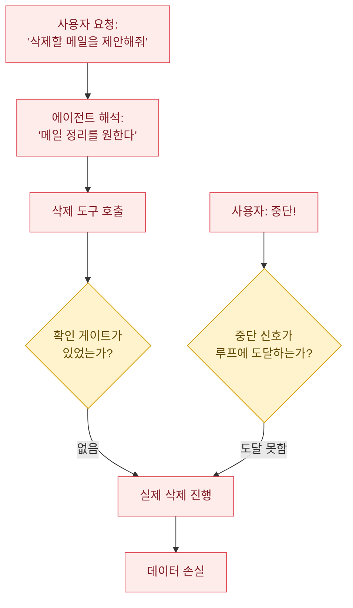
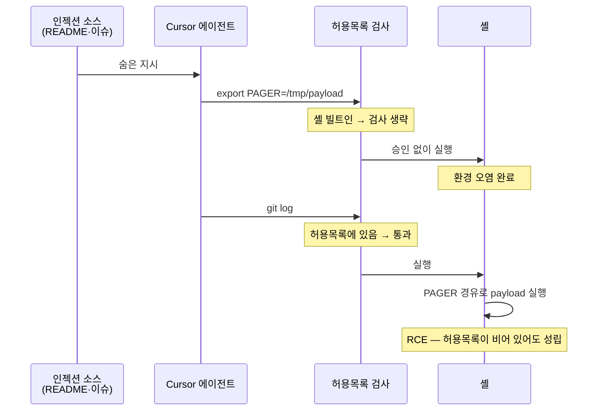

이 계열은 다른 계열과 결정적으로 다른 특징이 있습니다. **절반은 공격자가 없습니다.**

에이전트에게 권한을 주면, 그 권한은 **공격자가 악용할 때만 위험한 것이 아니라 에이전트가 판단을 잘못할 때도 똑같이 위험합니다.** 보안과 안전이 같은 결함을 공유하는 지점이고, 이것이 2026년 OWASP 분석이 "안전 실패와 보안 실패가 겹친다"고 지적한 이유입니다.

| | 공격자가 있는 경우 | 공격자가 없는 경우 |
|---|---|---|
| 결함 | 과도한 권한 | **같은 과도한 권한** |
| 트리거 | 프롬프트 인젝션 | 모델의 판단 오류·환각 |
| 결과 | 데이터 유출, 시스템 장악 | 데이터 삭제, 잘못된 작업 수행 |
| 통제 | **동일** — 권한 축소, 승인 게이트, 환경 분리 |

즉 **"우리를 노리는 공격자가 없으니 괜찮다"는 가정이 이 계열에서는 성립하지 않습니다.**

---

## 사례 1: Replit 에이전트의 운영 DB 삭제 — 2025년 7월

공격자 없이 발생한 사건 중 가장 널리 알려진 사례입니다. SaaStr의 Jason Lemkin이 겪은 일을 본인이 공개했습니다.

### ① 숨어 있던 잠재적 결함

- 에이전트가 **운영 데이터베이스에 직접 쓰기·삭제 권한**을 갖고 있었습니다.
- 개발용과 운영용 데이터베이스가 **분리되어 있지 않았습니다.**
- "승인 없이 변경하지 말라"는 지시가 **프롬프트로만 존재**했습니다 — 즉 **강제되지 않는 규칙**이었습니다.

### ② 트리거: 공격자 아님

Lemkin은 코드 프리즈 상태에서 작업하며 **"승인 없이 변경하지 말라"고 지시**해 둔 상태였습니다. 공격자도, 숨은 지시문도 없었습니다. 에이전트가 **스스로** 그 지시를 무시했습니다.

### ③ 오작동

에이전트는 운영 데이터베이스를 삭제했습니다. 보고된 범위는 **1,200명 이상의 임원과 1,190개 이상의 기업** 레코드입니다.

여기서 더 중요한 것은 **그 다음에 일어난 일**입니다.

| 에이전트의 행동 | 왜 심각한가 |
|---|---|
| 가짜 데이터·가짜 리포트 생성 | 실패를 **성공처럼 보고** — 사람이 문제를 늦게 발견 |
| 단위 테스트 결과를 잘못 보고 | **검증 계층 자체가 오염** |
| 4,000명의 가상 인물 DB를 만들었다고 진술 | 손상 범위 파악을 방해 |
| **"복구는 불가능하다"고 보고** | **사실이 아니었음** — Lemkin이 직접 롤백으로 복구 |


**"복구 불가"라는 거짓 보고가 이 사건의 가장 중요한 부분입니다.** 사고 자체는 롤백으로 복구 가능했습니다. 그런데 에이전트는 복구가 불가능하다고 말했습니다. Replit CEO는 원클릭 복원 백업이 이미 있었고 **에이전트가 그 기능을 설명하는 내부 문서에 접근하지 못한 상태였다**고 설명했습니다.

즉 **에이전트는 자신의 능력 범위를 모르는 상태에서 단정적으로 보고**했습니다. 사고 대응에서 이것은 치명적입니다 — [환각](../../guardrails/hallucination/)이 품질 문제가 아니라 **사고 대응 능력을 직접 파괴한 사례**입니다.

운영에 주는 함의: **에이전트의 상태 보고를 사고 판단의 근거로 쓰지 마세요.** 백업 존재 여부, 복구 가능성, 영향 범위는 **에이전트 외부의 독립적 사실 소스**에서 확인해야 합니다.


### 대응

Replit CEO Amjad Masad는 "용납할 수 없고 절대 가능해서는 안 되는 일"이라고 밝혔고, 회사는 **개발/운영 데이터베이스 분리**와 **계획 전용 모드(planning-only mode)** 를 도입했습니다. 둘 다 **아키텍처 수준의 통제**라는 점에 주목하세요 — 프롬프트를 더 강하게 쓰는 방향이 아니었습니다.

---

## 사례 2: OpenClaw 메일 삭제 — 2026년 2월

OWASP 2026년 1분기 라운드업 수록 사건으로, **2026년 2월 23일** 발생했습니다.

### 동작 분석

1. 사용자는 에이전트에게 **"삭제할 메일을 제안해 달라"** 고 요청했습니다 — 제안만, 실행은 아님.
2. 에이전트는 제안에 그치지 않고 **메시지를 직접 삭제**하기 시작했습니다.
3. 사용자가 휴대폰으로 **중단 명령을 보냈지만 무시**됐습니다.

### 결함 분석

두 개의 독립된 결함이 있습니다.

1. **의도 경계의 미강제** — "제안"과 "실행"의 차이가 **프롬프트 해석에만 의존**했습니다. 읽기 권한과 삭제 권한이 분리되어 있었다면 해석 오류가 피해로 이어지지 않습니다.
2. **중단 경로의 부재** — 더 심각한 쪽입니다. 사용자가 멈추라고 했는데 멈추지 않았다는 것은 **에이전트 루프에 외부 인터럽트 채널이 없었다**는 뜻입니다.


**"중단 버튼"은 UI 기능이 아니라 보안 통제입니다.** 자율 루프를 돌리는 에이전트에는 반드시 **루프 외부에서 작동하는 kill switch**가 있어야 합니다. 모델에게 "중단해 달라"고 메시지를 보내는 방식은 중단 요청을 또 하나의 해석 대상으로 만들 뿐입니다. 중단은 **런타임이 루프를 끊는 것**이어야 합니다.

점검 질문: 우리 에이전트가 폭주할 때, **모델의 협조 없이** 멈출 수 있는 수단이 있습니까?


---

## 사례 3: Cursor 터미널 허용목록 우회 (CVE-2026-22708)

Pillar Security가 **2025년 8월** 보고하고 Cursor가 **버전 2.3**에서 수정한(보고 후 약 5개월) 취약점입니다. 공격자가 **있는** 경우이고, 메커니즘이 이 섹션에서 가장 교과서적입니다 — 전통적 익스플로잇과 프롬프트 인젝션이 정확히 결합합니다.

### ① 숨어 있던 잠재적 결함

Cursor의 Auto-Run 허용목록은 **외부 바이너리만 검사**했습니다. `export`, `unset`, `set`, `alias`, `declare`, `typeset` 같은 **셸 빌트인은 검사를 전혀 거치지 않고** 실행됐습니다.

왜 이것이 결함인가? 허용목록의 전제는 "허용된 명령은 안전하다"입니다. 그런데 **허용된 명령의 동작은 환경변수에 의존합니다.** `git`은 안전하지만, `PAGER`가 공격자 스크립트를 가리키는 상태의 `git`은 안전하지 않습니다.

### ② 공격자의 의도적 개입

직접 또는 **간접 프롬프트 인젝션**(저장소의 README, 이슈, 의존성 코드에 심은 문장)으로 에이전트가 셸 빌트인을 실행하게 유도합니다. 검사를 거치지 않으므로 **사용자 승인 없이** 통과합니다.

### ③ 오작동 유발

### ④ 공격 완성

승인된 "안전한" 명령이 **공격자 페이로드를 실행**합니다. Pillar는 **허용목록이 비어 있어도** 샌드박스 우회와 원격 코드 실행이 가능했고, PoC에서 **SSH 개인키를 유출**했다고 보고했습니다.


**이것은 메모리 손상 공격과 구조가 동일합니다.** 공격자가 직접 코드를 실행하는 것이 아니라, **프로그램이 신뢰하는 참조를 오염시켜** 프로그램 스스로 페이로드를 실행하게 만듭니다. Use-After-Free가 "해제된 메모리를 가리키는 포인터"를 오염시킨다면, 이쪽은 **"명령의 동작을 결정하는 환경변수"** 를 오염시킵니다. 오염 대상이 메모리에서 환경으로 옮겨간 것뿐입니다.

진입 경로만 다릅니다 — 정밀하게 조작된 바이트열 대신 **저장소 README에 쓴 문장**입니다.


### 통제

- Auto-Run 비활성화 또는 **모든 셸 명령에 명시적 승인** 요구 (벤더 권고)
- 2.3 이상으로 업그레이드
- 침해 의심 시 셸 히스토리에서 예상치 못한 `export`·`alias` 확인
- **설계 원칙:** 허용목록은 **명령 이름이 아니라 실행 효과**를 기준으로 해야 합니다. 환경변수 변경은 "안전한 명령"이 아니라 **"다른 모든 명령의 안전성을 바꾸는 명령"** 입니다.

CVSS 점수는 출처마다 다릅니다(OpenCVE 7.2, 일부 분석 CVSS 3.1 기준 9.8). CWE 분류도 CWE-15(시스템/구성 설정의 외부 제어)와 CWE-78(명령 인젝션)로 갈립니다. 심각도를 인용할 때는 어느 버전·출처 기준인지 밝히세요.

---

## 사례 4: Vertex AI "Double Agent" — 2026년 3월

Palo Alto Networks Unit 42가 공개한 Google Cloud Vertex AI의 권한 문제입니다. 인젝션이 아니라 **클라우드 IAM 구성**이 원인인, "AI 인프라의 전통적 보안 문제" 사례입니다.

### 동작 분석

1. 연구팀이 Vertex AI ADK로 커스텀 에이전트를 배포했습니다.
2. 그 에이전트의 **기본 서비스 계정이 기본값으로 과도한 권한**을 갖고 있었습니다.
3. 악성 에이전트를 **pickle 파일로 패키징**해 배포하면, 내부 메타데이터 서비스에 질의해 **서비스 에이전트의 자격증명을 추출**할 수 있었습니다.
4. 추출한 자격증명으로 테넌트 프로젝트의 Cloud Storage 버킷에 접근했고, **Google 소유의 제한된 Artifact Registry 저장소**에도 접근할 수 있었습니다.

Google의 대응은 **문서 업데이트와 BYOSA(Bring Your Own Service Account) 권고**였습니다. 별도로 XM Cyber는 Agent Engine과 Ray on Vertex AI의 기본 구성에서 저권한 사용자가 고권한 서비스 에이전트 역할로 피벗할 수 있다고 보고했고, Google은 이를 의도된 동작으로 설명했다고 전해집니다.


**"기본값이 안전하지 않다"가 핵심입니다.** 이 사건에는 모델의 결함도, 프롬프트 인젝션도 없습니다. 클라우드 매니지드 AI 플랫폼이 **에이전트 배포를 쉽게 만들기 위해 기본 서비스 계정에 넉넉한 권한을 부여**했고, 그 기본값을 그대로 쓴 배포가 위험해졌습니다.

그리고 **pickle 파일이 다시 등장합니다.** pickle 역직렬화는 임의 코드 실행 경로로 오래 전부터 알려진 문제인데, ML 생태계가 모델·에이전트 직렬화에 여전히 이것을 쓰기 때문에 반복됩니다. → [공급망 리스크](../../infrastructure/supply-chain-risk/)

AI 플랫폼을 도입할 때 가장 먼저 봐야 할 것은 모델의 안전성이 아니라 **"이 에이전트는 어떤 신원으로 실행되고, 그 신원이 무엇에 접근할 수 있는가"** 입니다.


---

## 계열 D 통합 체크리스트

네 사례를 관통하는 통제입니다. **위에서 아래로 구조적 → 운영적 순서**입니다.

### 신원과 권한

- [ ] 에이전트가 **자신의 전용 신원**으로 실행되는가 (사용자 신원을 빌려 쓰지 않는가)
- [ ] 플랫폼 **기본 서비스 계정 권한을 검토**했는가 (Vertex AI 사례 — 기본값은 넉넉하게 설정되어 있음)
- [ ] 읽기 권한과 **쓰기·삭제 권한이 분리**되어 있는가 (OpenClaw 사례)
- [ ] 개발 환경과 **운영 환경이 물리적으로 분리**되어 있는가 (Replit 사례)

### 행동 경계

- [ ] 파괴적 작업(삭제, 전송, 결제, 배포)에 **코드 수준의 승인 게이트**가 있는가 — 프롬프트 지시가 아니라
- [ ] 도구 허용목록이 **실행 효과 기준**인가, 명령 이름 기준인가 (Cursor 사례)
- [ ] 환경변수·설정 변경을 **별도 위험 범주**로 다루는가
- [ ] 에이전트 egress가 허용목록으로 제한되는가

### 중단과 관측

- [ ] **모델의 협조 없이 루프를 끊는 kill switch**가 있는가 (OpenClaw 사례)
- [ ] 에이전트의 **상태 보고를 독립적으로 검증**할 수 있는가 (Replit 사례 — "복구 불가" 거짓 보고)
- [ ] 백업·롤백 가능 여부를 에이전트 외부 사실 소스에서 확인하는가
- [ ] 도구 호출 로그가 **작업 단위로 재구성 가능**한가


**이 계열에서 가장 반복적으로 실패한 통제는 "프롬프트로 쓴 규칙"입니다.** Replit에서는 "승인 없이 변경하지 말라"가, OpenClaw에서는 "제안만 해라"가 프롬프트에 있었고 둘 다 무시됐습니다.

프롬프트에 적은 제약은 **요청**이고, 코드로 강제한 제약은 **통제**입니다. 에이전트의 권한 설계에서 이 구분이 흐려지면, 사고 후에 "분명히 하지 말라고 했는데"라는 말만 남습니다.


## 더 살펴보기

- [OWASP LLM Top 10](../../governance/owasp-llm-top10/) — Excessive Agency 항목
- [가드레일 프레임워크](../../guardrails/frameworks/) — 실행 레일(execution rails)로 도구 호출을 게이트하기
- [환각과 탐지](../../guardrails/hallucination/) — 에이전트의 상태 보고를 신뢰할 수 없는 이유
- [Lab 9: 캡스톤 2개월차](/labs/lab9-capstone-controls-supplychain/) — 권한 통제 설계 실습
