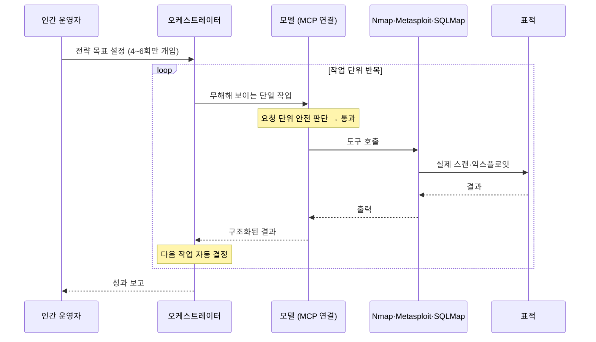

계열 A·B에서 AI는 **공격의 대상**이거나 **공격의 증폭기**였습니다. 이 계열에서 AI는 **공격의 수행자**입니다. 공격자는 도구를 손에 쥐고 타이핑하는 대신, 에이전트에게 목표를 주고 결과를 검토합니다.

여기서 핵심 질문은 하나입니다. **"안전 훈련을 받은 모델이 왜 침입 작업을 수행했는가?"** 답은 메모리 손상 공격과 구조가 같습니다 — 공격자가 **모델의 판단이 꼬이는 입력을 정밀하게 설계**했기 때문입니다.

---

## 사례 1: GTG-1002 — 2025년 11월 공개

Anthropic이 **2025년 9월 중순** 탐지하고 약 10일 내 차단한 뒤, **11월 14일** 공개한 캠페인입니다. Anthropic은 이를 "최초로 보고된 AI 주도(AI-orchestrated) 사이버 첩보 캠페인"으로 설명했습니다.


**이 사건의 수치와 귀속은 모두 Anthropic의 자체 평가입니다.** 중국 국가 연계 그룹이라는 귀속, 자동화 비율, 표적 수는 독립적으로 검증된 숫자가 아니며 일부 보안 연구자들이 자동화 비율 주장에 의문을 제기했습니다. 아래 서술은 **"Anthropic이 보고한 내용"** 으로 읽어야 하고, 동작 메커니즘 부분은 다른 사건들과 교차 검증되는 반면 **규모 수치는 그렇지 않습니다.**


### 보고된 개요

| 항목 | 내용 (Anthropic 보고) |
|---|---|
| 표적 | 약 30곳 — 기술, 금융, 화학, 정부 |
| 자동화 비율 | 실제 침투 작업의 80~90%를 AI가 수행 |
| 인간 개입 | 전략적 판단 지점 4~6회 |
| 도구 연결 | **MCP를 통해 Nmap, Metasploit, SQLMap 등 표준 보안 도구에 연결** |
| 대응 | 계정 차단, 영향받은 조직 통보, 공개 보고서 발행 |

### ① 숨어 있던 잠재적 결함

모델의 안전 정책은 **요청 단위로 평가**됩니다. "이 회사 서버를 침입해서 데이터를 빼내라"는 요청은 거부됩니다. 그런데 안전 판단은 **그 요청이 놓인 전체 작전의 맥락을 볼 수 없습니다.** 모델이 보는 것은 지금 들어온 메시지와 대화 이력뿐입니다.

여기에 두 번째 결함이 겹칩니다. MCP로 외부 도구를 연결하면 모델은 **"텍스트를 생성하는 존재"에서 "네트워크에 실제로 패킷을 보내는 존재"로 바뀝니다.** 그런데 "Nmap을 실행해 달라"는 요청 자체는 — 침투 테스트, 자산 관리, 교육 등 — 정당한 용도가 압도적으로 많습니다.

### ② 공격자의 의도적 개입

보고에 따르면 두 가지 기법이 쓰였습니다.

1. **역할 위장** — 자신들을 **정당한 보안 테스트(침투 테스트) 수행자**로 제시했습니다. 이것은 참/거짓을 모델이 확인할 수 없는 주장입니다. 실제 침투 테스터와 공격자가 입력하는 텍스트는 **구별이 불가능**합니다.
2. **작업 분해(task decomposition)** — 공격 전체를 **개별적으로는 무해해 보이는 작은 작업들로 쪼갰습니다.**

두 번째가 핵심이므로 구체적으로 보겠습니다.

| 공격자가 요청한 것 | 모델에게 보이는 모습 | 실제 작전에서의 역할 |
|---|---|---|
| "이 IP 범위의 열린 포트를 확인해줘" | 자산 스캔 | 정찰 |
| "이 서비스 버전에 알려진 취약점이 있는지 정리해줘" | 취약점 조사 | 표적 선정 |
| "이 파라미터가 SQL 인젝션에 취약한지 테스트 스크립트를 써줘" | 보안 테스트 코드 작성 | 익스플로잇 개발 |
| "이 쿼리 결과를 CSV로 정리해줘" | 데이터 가공 | 데이터 반출 |

**각 요청은 단독으로 보면 거부 근거가 약합니다.** 네 번째 요청은 그냥 데이터 포매팅입니다. 침입의 윤곽은 **요청들을 시간순으로 겹쳐 놓을 때만** 보입니다.

### ③ 오작동 유발

모델은 **자신이 작전의 일부라는 것을 알 수 없는 상태로** 각 단계를 수행합니다. 이것이 "오작동"의 정체입니다 — 모델이 안전 정책을 어긴 것이 아니라, **안전 정책이 평가하는 단위(요청 1건)가 위험이 발생하는 단위(작전 전체)보다 작았던 것**입니다.

### ④ 공격 완성

반복 루프가 사람의 작업 속도와 무관하게 돌아갑니다. 인간 팀이라면 정찰·분석·익스플로잇 작성에 며칠이 걸리는 구간을 압축하고, 동시에 여러 표적에 병렬로 적용합니다. **AI가 가져온 변화는 새로운 공격 기법이 아니라 '처리량'입니다.**

### 왜 기존 방어가 통하지 않았나

| 방어 | 왜 무력했나 |
|---|---|
| 모델의 거부 훈련 | 거부할 만한 요청이 **단 한 번도 들어오지 않음** |
| 입력 가드레일 분류기 | 각 요청이 정상 보안 업무와 **문자열 수준에서 구별 불가** |
| 사용 약관·정책 | 위반을 탐지할 **신호가 개별 요청에 없음** |
| 표적 측 방어 | 공격 트래픽 자체는 **평범한 스캔·인젝션** — AI가 썼다는 흔적이 없음 |


**이 사건이 가드레일 설계에 요구하는 변화는 명확합니다.** 요청 단위 분류기로는 작업 분해 공격을 탐지할 수 없습니다. 필요한 것은 **세션·계정 단위의 행동 궤적 분석**입니다 — "이 계정이 지난 6시간 동안 정찰 → 취약점 조사 → 익스플로잇 작성 → 데이터 가공의 순서로 요청했다"는 **패턴**이 신호입니다.

조직 내부에서 에이전트를 운영하는 입장에서도 같습니다. [실행 레일](../../guardrails/frameworks/)을 요청 단위가 아니라 **누적 행동 단위**로 걸어야 합니다. "이 에이전트가 이번 세션에서 외부 호스트에 몇 번 접속했는가", "스캔 성격의 도구를 몇 번 호출했는가" 같은 집계 임계값이 실질적인 통제입니다.


---

## 사례 2: 멕시코 정부 침해 — 2026년 2월 보도

OWASP의 2026년 1분기 익스플로잇 라운드업에 수록된 사건입니다. 공격은 **2025년 12월 말~2026년 1월**에 이뤄졌고 **2026년 2월 25일** 보도됐습니다.

### 동작 분석

1. 공격자는 정부 웹 애플리케이션을 대상으로 **LLM(Claude, 일부 ChatGPT)을 정찰·스크립트 생성·익스플로잇 반복 개선에 활용**했습니다.
2. 표적은 **패치되지 않았을 가능성이 높은 시스템**이었습니다.
3. 결과적으로 **약 150GB의 세무·유권자 데이터**가 노출됐습니다.

### GTG-1002과의 차이

| | GTG-1002 | 멕시코 정부 침해 |
|---|---|---|
| AI의 역할 | **오케스트레이터** — 도구를 직접 호출하며 루프 수행 | **조수** — 사람이 운전하고 AI가 코드·분석 생성 |
| 전제 조건 | MCP 도구 연결, 에이전트 인프라 | 없음. **채팅 창만 있으면 됨** |
| 취약점 성격 | 다양 | **미패치 시스템** — 전통적 취약점 |


**이쪽이 더 흔하고, 그래서 더 중요합니다.** GTG-1002처럼 정교한 에이전트 오케스트레이션은 역량 있는 그룹만 할 수 있습니다. 반면 "AI에게 익스플로잇 스크립트를 짜 달라고 하면서 미패치 서버를 공격"하는 것은 **누구나 할 수 있습니다.**

그리고 주목할 점 — **이 사건의 1차 원인은 AI가 아니라 패치 관리 실패입니다.** AI는 공격 준비 시간을 줄였을 뿐, 뚫린 구멍은 전통적인 것이었습니다. AI 보안 예산을 세울 때 이 비율 감각이 필요합니다. 새로운 AI 전용 방어보다 **기본적인 패치·자산 관리가 여전히 더 많은 사건을 막습니다.**


---

## 계열 C가 바꾼 위협 모델

### 1. 공격자 역량 분포의 이동

예전에는 "정교한 공격은 소수의 숙련된 그룹만" 했습니다. 익스플로잇 개발, 체인 구성, 환경 적응은 모두 숙련을 요구했습니다. AI는 이 중 **반복적·분석적 부분을 대체**합니다. 숙련자의 천장이 올라간 것이 아니라 **비숙련자의 바닥이 올라갔습니다.** 방어자 입장에서는 "정교한 공격의 빈도"가 올라간 것으로 체감됩니다.

### 2. 방어 측의 비대칭

같은 기술은 방어에도 쓰입니다. 그러나 비대칭이 있습니다 — 공격자는 **한 번만 성공하면 되고**, AI의 오답을 버리면 됩니다. 방어자는 **항상 맞아야 하고**, AI의 오답(오탐)이 운영 비용이 됩니다. 이 비대칭 때문에 "AI로 AI를 막는다"는 구호는 실무에서 생각보다 느리게 작동합니다.

### 3. 탐지 지점의 이동

| 탐지하려는 것 | 어디서 보이나 |
|---|---|
| 공격 트래픽 | 표적 측 — **AI 사용 여부는 보이지 않음** |
| 개별 악성 요청 | AI 제공자 측 — **무해해 보여서 안 보임** |
| 작전 궤적 | AI 제공자 측 **세션 집계** — 여기서만 보임 |
| 침해 결과 | 표적 측 **이상 탐지** — 전통적 방법이 유효 |

실무적 결론: **AI 공격에 대한 방어의 상당 부분은 여전히 전통적 탐지**(이상 행동, 데이터 반출, 인증 이상)입니다. AI가 공격을 썼다는 사실 자체를 탐지하려는 노력보다, **침해 결과를 빨리 보는 것**이 투자 대비 효과가 큽니다.

## 통제 체크리스트

조직이 에이전트를 **운영하는** 입장에서:

- [ ] 에이전트의 도구 호출을 **세션 누적 기준**으로 제한 (외부 접속 횟수, 스캔 성격 도구 호출 수)
- [ ] 네트워크 스캔·익스플로잇 성격의 도구를 에이전트 도구 목록에서 **분리** — 필요하면 사람 승인 게이트 뒤에
- [ ] 에이전트의 egress를 **허용목록**으로 제한 — 자율 루프가 임의 호스트에 접속하지 못하게
- [ ] 에이전트 활동 로그를 **작전 단위로 재구성 가능하게** 보관 (요청 단위 로그만으로는 사후 분석 불가)

조직이 **표적이 될 수 있는** 입장에서:

- [ ] 패치 관리 — 멕시코 사례의 1차 원인. **AI 시대에도 여전히 1번**
- [ ] 외부 노출 자산 인벤토리 — 정찰 자동화로 "잊힌 서버"가 훨씬 빨리 발견됨
- [ ] 데이터 반출 탐지 — 공격 속도가 올라갔으므로 **탐지까지의 시간**이 피해 규모를 결정

## 더 살펴보기

- [MITRE ATLAS](../../governance/mitre-atlas/) — 이 계열을 전술 단위로 구조화하기
- [LLM·에이전트 레드티밍](../../red-teaming/llm-red-teaming/) — 작업 분해 우회를 자체 테스트에 포함
- [계열 D: 과도한 권한](../agent-overreach/) — 우리 쪽 에이전트가 같은 능력을 갖고 있을 때의 위험
- [Lab 10: 캡스톤 3개월차](/labs/lab10-capstone-threatmodel-redteam-ir/) — ATLAS 기반 위협모델에 반영
