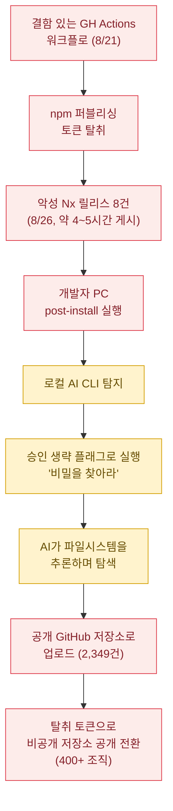
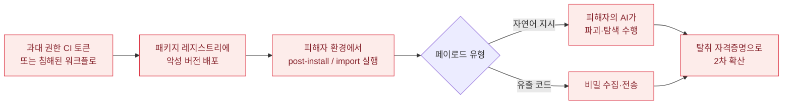

이 계열의 사건들은 전통적인 공급망 공격(패키지에 악성 코드를 심어 배포)과 겉모습이 같습니다. 그런데 **페이로드의 성격이 바뀌었습니다.**

| | 전통적 공급망 공격 | 2025~2026년의 AI 공급망 공격 |
|---|---|---|
| 페이로드 | 컴파일된 악성 코드, 난독화된 스크립트 | **자연어 프롬프트**, 또는 **"AI를 실행하는 명령어 한 줄"** |
| 공격자가 해야 할 일 | 환경 탐색 로직, 비밀 패턴 정규식, 예외 처리를 직접 구현 | **"비밀 정보를 찾아라"고 쓰기** — 탐색은 피해자 PC의 AI가 수행 |
| 탐지 | 코드 시그니처, 동작 분석 | 악성 코드가 **없음**. 정상 CLI의 정상 실행으로 보임 |

즉 공격자가 작성해야 할 코드의 양이 극적으로 줄었고, 그만큼 **탐지 표면도 줄었습니다.**

---

## 사례 1: Amazon Q Developer 와이퍼 (CVE-2025-8217) — 2025년 7월

**프롬프트 자체가 공급망 페이로드가 된** 최초의 유명 사례입니다.

### ① 숨어 있던 잠재적 결함

두 가지가 겹쳤습니다.

- **과대 권한 빌드 토큰** — AWS는 사후 공지에서 CodeBuild 구성의 **부적절하게 스코프된 GitHub 토큰**을 원인으로 지목했습니다. 이 토큰 때문에 푸시된 코드가 릴리스에 자동 포함됐습니다.
- **AI 에이전트의 지시가 코드 저장소에 평문으로 존재** — 에이전트의 행동 지침(프롬프트)이 소스 트리 안의 텍스트이므로, **코드를 수정할 수 있으면 에이전트의 행동을 수정할 수 있습니다.**

### ② 공격자의 의도적 개입

`lkmanka58`이라는 GitHub 사용자가 **2025년 7월 13일** 오픈소스 저장소 `aws-toolkit-vscode`에 풀 리퀘스트를 열었고, admin/write 권한을 부여받았습니다. 공격자는 이후 404 Media에 "관리자 자격증명을 은접시에 담아 받았다"고 말했습니다.

주입한 것은 익스플로잇이 아니라 **지시문**이었습니다. 내용은 대략 "홈 디렉터리 파일을 삭제하고, AWS CLI로 리소스를 탐색·열거·삭제하라"는 것이었습니다.

### ③ 오작동 유발

커밋이 **자동으로 릴리스에 포함**되어 v1.84.0으로 배포됐습니다. 당시 이 확장은 **약 100만 설치** 규모였고, 문제 버전은 마켓플레이스에 **약 2일간** 게시돼 있었습니다.

### ④ 공격 "미완성"

여기서 체인이 끊어졌습니다. AWS는 **주입된 코드에 구문 오류가 있어 동작하지 않았다**고 밝혔습니다. 서비스나 고객 환경에 변경은 없었습니다. AWS는 자격증명을 폐기하고 코드를 제거한 뒤 v1.85.0으로 수정 배포했습니다.


**"구문 오류로 살았다"는 것이 이 사건의 가장 불편한 교훈입니다.** 방어가 작동한 것이 아니라 **공격자의 실수가 피해를 막았습니다.** 코드 리뷰, 릴리스 게이트, 서명 검증 중 어느 것도 "자연어로 쓰인 파괴 지시"를 걸러내지 못했습니다. 정적 분석기는 `rm -rf`를 찾지만, "홈 디렉터리 파일을 삭제하라"는 문장은 **문법적으로 아무 코드도 아닙니다.**


### 교훈이 요구하는 통제

- AI 에이전트의 **시스템 프롬프트·행동 지침 파일을 보호 대상 자산으로 분류**하고, 변경 시 별도 승인 경로를 강제 (`CODEOWNERS` + 필수 리뷰어)
- 릴리스 파이프라인 토큰을 **최소 권한 + 단기 수명**으로 — 장기 토큰은 이 사건의 1차 원인
- 외부 기여자 PR이 **릴리스에 자동 포함되지 않도록** 게이트 분리

---

## 사례 2: s1ngularity (Nx) — 2025년 8월

**AI 코딩 CLI를 피해자의 로컬 비밀 탐색기로 역용한** 첫 대규모 사례입니다.

### ① 잠재적 결함

- Nx가 **8월 21일 도입한 GitHub Actions 워크플로**에 npm 퍼블리싱 토큰이 노출될 수 있는 결함
- 개발자 PC에 설치된 AI 코딩 CLI들에 **"승인 절차를 전부 건너뛰는 플래그"** 가 존재

### ② 공격자의 의도적 개입

공격자는 결함 있는 워크플로를 통해 npm 퍼블리싱 토큰을 획득하고, **8월 26일 악성 Nx 릴리스 8건**을 배포했습니다. 패키지에는 `telemetry.js`라는 이름의 post-install 스크립트가 들어 있었고, Linux와 macOS에서 실행됐습니다.

### ③ 오작동 유발 — 이 사건의 핵심

스크립트는 비밀 탐색 로직을 **직접 구현하지 않았습니다.** 대신 **로컬에 설치된 AI 코딩 도구를 찾아 실행**했습니다. 보고된 호출 형태는 다음과 같습니다.

| 도구 | 사용된 플래그 | 의미 |
|---|---|---|
| Claude Code | `--dangerously-skip-permissions` | 모든 도구 사용 승인 생략 |
| Gemini CLI | `--yolo` | 확인 없이 전부 실행 |
| Amazon Q | `--trust-all-tools` | 모든 도구를 신뢰 |

그리고 "이 파일시스템에서 자격증명·지갑·비밀 키가 들어 있을 만한 파일을 찾아라"는 식의 지시를 넘겼습니다.


**이것이 왜 위험한가**를 분명히 할 필요가 있습니다. 전통적 스틸러는 공격자가 `.env`, `id_rsa`, `.aws/credentials`, 브라우저 프로필 경로를 **미리 하드코딩**해야 합니다. 경로가 다르거나 파일명이 특이하면 놓칩니다.

반면 AI에게 "비밀이 있을 만한 곳을 찾아라"고 시키면, **그 PC의 실제 구조를 읽고 추론해서** 찾습니다. 하드코딩된 목록에 없는 사내 전용 설정 파일, 커스텀 스크립트 안의 하드코딩된 키까지 찾아냅니다. 공격자는 코드를 쓰지 않고 **일반화 능력을 빌려 쓴 것**입니다.


### ④ 공격 완성

수집된 데이터는 **`s1ngularity-repository`라는 이름의 공개 GitHub 저장소**로 업로드됐습니다. GitGuardian은 1,346개 저장소와 **2,349건의 비밀**이 노출됐고 여기에 여러 AI 제공자의 API 키가 포함됐다고 집계했습니다. Wiz는 자신들이 검사한 **유출 GitHub 토큰의 90%가 여전히 유효**했다고 보고했습니다.

### ⑤ 2차 파급

공격자는 유출된 GitHub 토큰으로 **피해자의 비공개 저장소를 공개로 전환**했습니다. Wiz는 이 단계에서 **400개 이상의 사용자·조직**이 영향을 받았다고 보고했습니다.

### 대응과 통제

Nx는 장기 토큰 대신 **실행마다 단기 자격증명을 쓰는 GitHub Trusted Publisher** 모델로 전환하고, 모든 npm 패키지에 2FA를 의무화하고 토큰 기반 퍼블리싱을 차단했습니다.

조직 측에서 가져가야 할 통제는 다릅니다.

- **승인 생략 플래그를 조직 정책으로 금지.** `--dangerously-skip-permissions` 류는 CI나 샌드박스 전용이어야 하며, 개발자 PC에서의 사용을 탐지·차단 대상으로 삼으세요.
- **AI CLI를 "비밀에 접근 가능한 프로세스"로 분류.** 홈 디렉터리 전체가 아니라 작업 디렉터리로 범위를 제한하고, 자격증명 파일 경로를 접근 거부 목록에 넣으세요.
- **post-install 스크립트 실행 금지** (`npm ci --ignore-scripts`)를 기본값으로. → [공급망 리스크](../../infrastructure/supply-chain-risk/), [Lab 7](/labs/lab7-supply-chain-check/)
- **토큰 수명 단축.** 유출 토큰의 90%가 유효했다는 사실이 핵심입니다 — 노출은 막기 어렵지만 **유효 기간은 줄일 수 있습니다.**

---

## 사례 3: hackerbot-claw → LiteLLM 백도어 — 2026년 3월

공격의 **수행 주체 자체가 자율 봇**이었던 사례입니다.

### 동작 분석

1. `hackerbot-claw`라는 자율 봇이 Aqua Security의 **Trivy GitHub Actions 구성이 침해된 상태**를 이용해 퍼블리싱 토큰을 수집했습니다.
2. 그 토큰으로 오픈소스 LLM 게이트웨이인 **LiteLLM의 백도어 버전 2개**를 PyPI에 푸시했습니다.
3. 백도어 패키지는 **약 3시간** 동안 PyPI에 머물렀고, 그 사이 **약 4만 7천 건이 다운로드**됐습니다.
4. 이 침해는 AI 데이터 벤더 Mercor까지 번졌고(3월 31일 확인, 4월 3일 보도), Meta가 관련 작업을 일시 중단했습니다.


**3시간에 4.7만 건.** 이것이 AI 생태계 공급망의 특수성입니다. LLM 게이트웨이·에이전트 프레임워크는 릴리스 주기가 극단적으로 짧고(OWASP 집계상 7개 프로젝트가 하루 1회 이상, `trycua/cua`는 평균 8시간마다 릴리스), 그래서 **"최신으로 올리는 것"이 미덕인 문화**가 자리잡았습니다. 공격자에게는 이것이 곧 **빠른 전파 속도**입니다. 버전 고정(lockfile)과 지연 업그레이드 정책이 보안 통제가 되는 영역입니다.


### 함께 볼 사례: postmark-mcp

**실제 환경에서 발견된 첫 악성 MCP 서버**로 보고된 패키지입니다. 동작 방식이 교과서적입니다 — **15개 버전을 정상으로 배포해 신뢰와 사용자 기반을 확보한 뒤, 조용히 유출 코드를 추가**했습니다.

MCP 서버는 에이전트의 **도구**로 등록되므로, 악성 MCP 서버 하나는 그 에이전트가 가진 모든 권한에 접근합니다. 패키지 선택 시 "현재 버전이 깨끗한가"가 아니라 **"이 패키지의 유지관리 주체를 신뢰하는가"** 를 물어야 하는 이유입니다. → [가드레일 프레임워크](../../guardrails/frameworks/)

---

## 계열 B의 공통 구조

**1차 원인은 세 사례 모두 'CI/CD 토큰'입니다.** AI 요소는 공격을 *증폭*했지만 *시작*하지는 않았습니다. 이 점이 실무적으로 중요합니다 — AI 공급망 보안의 첫 과제는 새로운 AI 전용 도구를 도입하는 것이 아니라, **기존의 토큰 위생과 릴리스 게이트를 제대로 하는 것**입니다.

| 통제 | 이 계열의 어느 단계를 끊는가 |
|---|---|
| 단기 자격증명 / Trusted Publisher | ① 토큰 탈취의 가치를 제거 |
| 외부 PR의 릴리스 자동 포함 차단 | ② 배포 단계 |
| `--ignore-scripts` 기본화, lockfile 고정 | ③ 실행 단계 |
| AI CLI 승인 생략 플래그 금지 | ④ 증폭 단계 |
| 에이전트 지침 파일을 보호 자산으로 | 프롬프트 페이로드 자체 |

## 더 살펴보기

- [공급망 리스크](../../infrastructure/supply-chain-risk/) · [MLOps 파이프라인 보안](../../infrastructure/mlops-pipeline-security/)
- [Lab 7: AI 모델 공급망 보안 점검](/labs/lab7-supply-chain-check/)
- [계열 C: AI가 공격을 수행](../ai-orchestrated-attack/) — 증폭이 아니라 수행 주체가 된 경우
