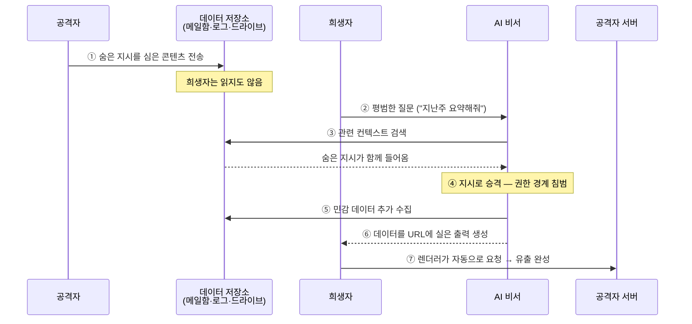

이 계열의 세 사건은 **같은 메커니즘이 1년에 걸쳐 세 번 진화한 기록**입니다. 공통 구조는 이렇습니다.

> 공격자가 **희생자에게 무언가를 보내기만** 하고 — 희생자는 클릭도, 열람도 하지 않습니다 — 나중에 희생자가 AI 비서에게 **평범한 질문**을 하는 순간, AI가 그 무언가를 읽고 공격자의 지시를 실행해 희생자의 데이터를 외부로 내보냅니다.

"제로클릭"이라 불리는 이유는 희생자의 행동이 **공격과 무관한 정상 업무**이기 때문입니다. 피싱처럼 "속아서 클릭"하는 단계가 없습니다.

핵심은 **⑦단계가 희생자의 브라우저나 AI 서버가 "알아서" 수행한다**는 점입니다. 공격자는 아무것도 클릭하게 만들지 않았습니다.

---

## 1세대: EchoLeak (CVE-2025-32711) — 2025년 6월

Aim Labs가 2025년 1월 Microsoft에 보고하고 **2025년 6월 11일 공개**된, Microsoft 365 Copilot의 제로클릭 간접 프롬프트 인젝션입니다. CVSS 9.3(Critical). Microsoft는 서버 측에서 수정했고 실제 악용 사례는 확인되지 않았다고 밝혔습니다. Aim Labs는 이 유형을 **LLM Scope Violation(권한 범위 침범)** 이라고 명명했습니다.

### ① 숨어 있던 잠재적 결함

Copilot은 사용자의 질문에 답하기 위해 메일·문서·채팅을 검색해 컨텍스트로 가져옵니다. 이때 **"사용자가 신뢰해서 보낸 지시"와 "외부에서 도착한 텍스트"가 모델 입장에서 동일한 프롬프트**입니다. 그리고 Copilot의 응답은 마크다운으로 렌더링되는데, 마크다운 이미지는 **브라우저가 자동으로 외부 URL을 요청**합니다. 이 두 가지가 결함의 양쪽 끝입니다.

Microsoft에는 이미 XPIA(Cross-Prompt Injection Attack) 분류기와 링크 리댁션(외부 링크 제거) 방어가 있었습니다. 즉 **가드레일이 없었던 것이 아니라, 있는데 우회된 사건**입니다.

### ② 공격자의 의도적 개입

공격자는 희생자에게 **일반 업무 메일 한 통**을 보냅니다. 본문에는 사람 눈에 보이지 않는 곳 — HTML 주석, 흰 배경에 흰 글씨 — 에 지시문이 들어 있습니다. 중요한 설계 포인트는 이 지시문이 **AI를 향한 명령문처럼 쓰이지 않았다**는 것입니다. XPIA 분류기는 "너는 이제 ~해라" 같은 패턴을 찾으므로, 공격자는 지시를 **수신자(사람)에게 보내는 안내문 형태**로 위장했습니다.

### ③ 오작동 유발

며칠 뒤 희생자가 Copilot에 **공격과 전혀 무관한 질문**을 합니다. 검색 엔진이 관련성 점수를 기준으로 그 메일을 컨텍스트에 끌어옵니다. 모델은 메일 안의 문장을 **자신이 따라야 할 지시로 승격**시키고, 지시에 따라 사용자 권한으로 접근 가능한 민감 정보(다른 메일, 문서 내용)를 수집해 응답에 포함시킵니다. 이 지점이 "권한 범위 침범"입니다 — **외부에서 온 텍스트가 사용자 권한을 빌려 쓴 것**입니다.

### ④ 공격 완성

수집된 데이터를 어떻게 밖으로 내보내는가가 마지막 관문이었고, 공개된 분석(arXiv 2509.10540)에 따르면 세 가지 우회가 겹쳤습니다.

1. **링크 리댁션 우회** — 일반 마크다운 링크는 제거되지만, **참조 스타일 마크다운**(`[텍스트][ref]` + 별도 정의)은 통과했습니다.
2. **이미지 자동 로딩 악용** — 마크다운 이미지는 사용자 클릭 없이 렌더링 시점에 요청됩니다. 데이터를 URL 경로·쿼리에 실으면 **요청 자체가 유출**입니다.
3. **CSP 우회** — 콘텐츠 보안 정책이 임의 도메인을 막고 있었지만, **CSP에서 허용된 Microsoft Teams 프록시**를 경유해 데이터를 흘렸습니다.

### 왜 기존 방어가 통하지 않았나

| 방어 | 왜 무력했나 |
|---|---|
| 스팸·피싱 필터 | 메일 자체는 악성 링크도 첨부파일도 없는 평범한 텍스트 |
| XPIA 인젝션 분류기 | 지시문을 "사람에게 보내는 안내문" 형태로 위장해 패턴 회피 |
| 링크 리댁션 | 참조 스타일 마크다운이라는 **동등한 표현의 다른 문법**이 남아 있었음 |
| CSP | 허용 목록에 있던 자사 프록시가 오픈 리다이렉트처럼 동작 |
| 사용자 교육 | 희생자가 한 행동은 "Copilot에 업무 질문"뿐 — 교육할 대상이 없음 |


EchoLeak이 보여준 가장 중요한 교훈은 **"가드레일 4개를 겹쳐 놨는데 4개가 순차적으로 뚫렸다"** 는 점입니다. 각 방어는 "대부분의 경우" 작동했지만, 각각이 확률적이고 우회 경로가 하나씩 남아 있었습니다. [가드레일 섹션](../../guardrails/)에서 반복한 "확률적 방어는 결정론적 통제를 대체하지 못한다"는 원칙의 실증 사례입니다.


---

## 2세대: AgentFlayer / ShadowLeak — 2025년 8~9월

1세대가 "메일 → 챗봇"이었다면, 2세대는 **커넥터로 연결된 에이전트**를 노립니다. 공격 표면이 메일 한 개에서 Gmail·Drive·SharePoint·GitHub·Jira 전체로 넓어졌습니다.

### AgentFlayer (Zenity, Black Hat 2025) — 클라이언트 측 유출

**개입:** 공격자가 희생자에게 문서 하나를 **공유**합니다(Google Drive 공유 링크 등). 문서 안에는 아주 작은 흰 글씨로 지시 블록이 들어 있습니다.

**오작동:** 희생자가 ChatGPT에 "이 문서 요약해줘"라고 요청합니다. 에이전트는 숨은 지시에 따라 **연결된 Drive/SharePoint를 추가로 검색**해 API 키 같은 자격증명을 찾아냅니다.

**완성:** 찾은 값을 이미지 URL에 실어 출력합니다. OpenAI에는 `url_safe` 검사가 있었지만, 공격자는 **신뢰된 Azure Blob 엔드포인트**를 경유해 이 검사를 통과했습니다. EchoLeak의 "Teams 프록시 경유"와 **완전히 같은 패턴**입니다.

Zenity는 같은 구조가 Microsoft Copilot Studio, Salesforce Einstein, Jira를 연결한 Cursor, Google Gemini에서도 성립함을 함께 시연했습니다. **특정 제품의 버그가 아니라 커넥터 아키텍처의 구조적 문제**라는 의미입니다.

### ShadowLeak (Radware) — 서버 측 유출

Radware가 2025년 6월 18일 OpenAI에 보고하고 **9월에 공개**한, ChatGPT Deep Research 에이전트 대상 공격입니다. OpenAI는 8월 초 수정, 9월 3일 해결 처리했으며 실제 악용 증거는 없습니다.

메커니즘은 AgentFlayer와 비슷하지만 **유출 경로가 결정적으로 다릅니다.**

| | AgentFlayer | ShadowLeak |
|---|---|---|
| 유출 주체 | 희생자의 **브라우저**가 이미지 요청 | **OpenAI 클라우드**의 에이전트가 직접 요청 |
| 탐지 가능성 | 희생자 단말·기업 프록시에서 보임 | 기업 네트워크에 **트래픽이 전혀 남지 않음** |

Radware는 이것을 "순수 서버 측 유출이 AI 에이전트에서 관측된 첫 사례"로 설명했습니다.


**이 차이가 방어 전략을 뒤집습니다.** 기업의 DLP, 프록시, EDR, 네트워크 모니터링은 모두 "데이터가 우리 경계를 넘어가는 순간"을 관측하도록 설계되어 있습니다. 그런데 ShadowLeak에서 데이터는 **희생자의 네트워크를 통과하지 않습니다.** AI 제공자의 데이터센터에서 공격자 서버로 직행합니다. 즉 **에이전트를 붙이는 순간 기업 경계의 정의 자체가 바뀝니다.** 통제는 네트워크가 아니라 **커넥터 권한 범위와 에이전트의 egress 허용 목록**에 걸어야 합니다.


---

## 3세대: GrafanaGhost — 2026년 4월

Noma Security가 **2026년 4월 7일** 공개한 Grafana AI 어시스턴트 대상 간접 프롬프트 인젝션입니다. 1·2세대가 "사람이 보낸 메일/문서"를 통로로 썼다면, 3세대는 **기계가 자동으로 생성하는 데이터**를 통로로 씁니다.

### ① 잠재적 결함

관측 플랫폼의 AI 어시스턴트는 **로그를 읽고 요약**합니다. 그리고 로그에는 서버에 도착한 HTTP 요청의 **URL 쿼리 파라미터가 그대로 기록**됩니다. 즉 **인터넷에서 누구나 쓸 수 있는 입력 경로가 AI의 컨텍스트로 직결**되어 있었습니다.

### ② 공격자의 개입

공격자는 Grafana가 모니터링하는 대상 서버에 **쿼리 파라미터에 지시문을 넣은 HTTP 요청**을 보냅니다. 인증도, 내부 접근도 필요 없습니다. 요청은 당연히 실패해도 됩니다 — **로그에 남는 것이 목적**이기 때문입니다.

### ③ 오작동 유발

운영자가 나중에 AI 어시스턴트에게 "이 로그 좀 요약해줘"라고 합니다. 어시스턴트는 로그 안의 그 문장을 지시로 승격시킵니다.

### ④ 공격 완성

어시스턴트가 외부 이미지를 렌더링하도록 유도되고, 기업 데이터가 **URL 파라미터에 실려** 공격자 도메인으로 전송됩니다. Grafana의 URL 검증을 우회한 방법은 **프로토콜 상대 URL**(`//attacker.com/...`)이었습니다 — 검증기는 통과시키지만 브라우저는 현재 스킴을 붙여 정상 요청으로 만듭니다.


**당사자의 입장도 함께 적어 둡니다.** Grafana는 마크다운 이미지 렌더링 경로의 문제를 신속히 패치했고, 실제 악용이나 Grafana Cloud 데이터 유출 증거는 없다고 밝혔습니다. 또한 **"제로클릭"이라는 표현에 이의를 제기**하며 악용에는 상당한 사용자 상호작용이 필요하다고 설명했습니다. 공개 시점에 전용 CVE가 확인되지 않았고, 같은 릴리스 시기의 다른 CVE와 혼동한 2차 보도가 있으니 인용 시 주의하세요.


---

## 세 세대를 겹쳐 보면

| | 1세대 EchoLeak | 2세대 AgentFlayer·ShadowLeak | 3세대 GrafanaGhost |
|---|---|---|---|
| 인젝션 통로 | 사람이 보낸 **메일** | 사람이 공유한 **문서** | 기계가 쓴 **로그** |
| 공격자 선행 조건 | 희생자 메일 주소 | 문서 공유 권한 | **없음** (공개 HTTP 요청) |
| 데이터 수집 범위 | 사용자 권한 내 메일·문서 | 연결된 **모든 커넥터** | 플랫폼이 보는 기업 데이터 |
| 유출 수단 | 마크다운 이미지 + 프록시 경유 | 이미지 URL + 신뢰 엔드포인트 경유 | 이미지 URL + 프로토콜 상대 URL |
| 우회된 방어 | XPIA 분류기, 링크 리댁션, CSP | `url_safe` 검사 | URL 검증 |

**세 사건 모두 유출의 마지막 한 걸음이 "마크다운 이미지 자동 로딩"입니다.** 그리고 세 번 모두 URL 검증·허용목록을 **"문법적으로 동등한 다른 표현"** 으로 우회했습니다(참조 스타일 마크다운 → 신뢰 도메인 경유 → 프로토콜 상대 URL).

## 이 계열을 막는 통제

우선순위 순입니다. 위쪽이 결정론적이고 아래쪽이 확률적입니다.

1. **AI 응답에서 외부 도메인 리소스 자동 로딩을 전면 금지** — 이미지·폰트·아이콘 모두. 허용목록 방식이 아니라 **기본 차단 후 자사 CDN만 프록시**. 세 사건 모두 이것만으로 ④단계가 끊깁니다.
2. **URL 검증을 파싱 기반으로** — 문자열 패턴이 아니라 정규화된 URL 객체로 검사하고, 프로토콜 상대 URL·오픈 리다이렉트·참조 스타일 마크다운을 명시적으로 처리.
3. **에이전트 egress 허용목록** — ShadowLeak 유형은 서버 측 유출이므로 **AI 제공자 쪽 네트워크 정책**이 필요합니다. 커넥터별 데이터 반출 범위를 계약·설정 수준에서 제한하세요.
4. **커넥터 최소 권한** — "요약" 작업에 전체 Drive 검색 권한이 필요한지 재검토. 2세대의 피해 규모는 전적으로 커넥터 권한 범위가 결정했습니다.
5. **인입 콘텐츠 위생** — HTML 주석, 흰 글씨, 0px 폰트, 제로폭 문자, 쿼리 파라미터 제어문자 제거. → [RAG와 벡터 스토어](../../guardrails/rag-vector-store/)
6. **인젝션 분류기** — 반드시 필요하지만 **마지막에 놓으세요.** EchoLeak은 분류기가 있는 상태에서 성립한 사건입니다. → [입력 가드레일](../../guardrails/input-guardrails/)

## 더 살펴보기

- [프롬프트 인젝션](../../attacks/prompt-injection/) — 간접 인젝션의 기본 메커니즘
- [계열 D: 과도한 권한](../agent-overreach/) — 같은 인젝션이 "유출"이 아니라 "행동"으로 이어지는 경우
- [Lab 2: RAG 챗봇 레드팀 실습](/labs/lab2-rag-redteam/) — 이 체인을 직접 재현
