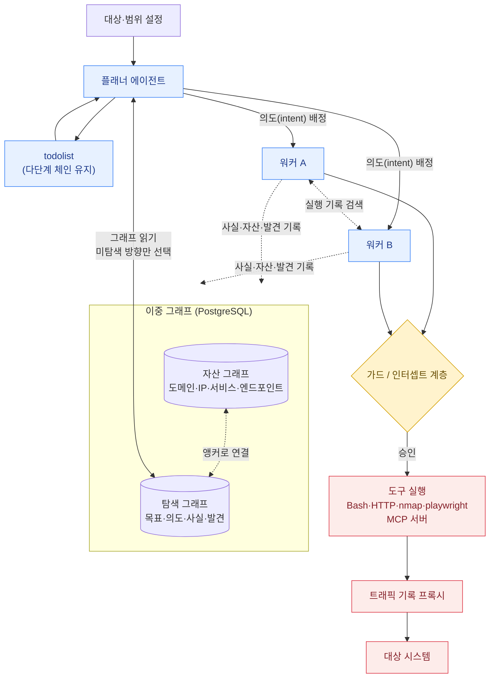

ARTEX는 LLM 멀티에이전트로 침투 테스트 전 과정을 자동화하는 오픈소스 도구입니다. 중국 개발자(핸들 Autumn-27)가 만들어 GitHub에 공개했고, Baidu의 "agent+" 공방 챌린지 우승 이력을 내세웁니다. 이 지식베이스에서 다루는 이유는 두 가지입니다.

1. <strong>방어자에게 필요한 도구</strong>입니다. 자사 외부 공격 표면을 자동으로 두들겨 보는 용도로 쓸 수 있습니다.
2. <strong>2026년 9~10월 한국 금융권 침해 사건에서 공격에 쓰인 도구</strong>로 보고됐습니다. 동작 방식을 모르면 이 유형의 공격을 탐지할 수도, 시나리오에 반영할 수도 없습니다. 사건 분석은 [계열 C: AI가 공격을 수행](/docs/incidents/ai-orchestrated-attack/)에 있습니다.


<strong>이 페이지는 동작 원리와 방어 관점의 설명입니다.</strong> 작성자는 ARTEX 저장소에서 "개인 학습·코드 연구·격리된 로컬 환경에서의 기술 검증"만 허용하고 실제 운영 중인 외부 시스템에 대한 사용을 명시적으로 금지합니다. 소유하지 않았거나 서면 허가가 없는 대상에 사용하면 정보통신망법·개인정보보호법 위반이 될 수 있습니다. 이 페이지에는 대상을 공격하는 명령어를 싣지 않았습니다.


## 한눈에 보기

| 항목 | 내용 |
|---|---|
| 정체 | LLM 기반 자율 침투 테스트 시스템 (멀티에이전트) |
| 기술 스택 | Go 백엔드 + Next.js 프론트엔드(바이너리에 내장) + PostgreSQL, `norma` 에이전트 SDK |
| 배포 형태 | Docker Compose, 설치 스크립트, 소스 빌드. 상대적으로 높은 사양 필요 |
| 라이선스 | AGPL-3.0 |
| 지원 모델 | Anthropic·OpenAI 키 설정 지원, 그 외 API 호환 백엔드 연결 가능 |
| 확장 | MCP 서버(Streamable HTTP/SSE), skills, memory, 리포트 생성, ScopeSentry 자산 동기화 |
| 한국어판 | 2026년 10월 한국어 포크가 GitHub에 공개됨 (출처·기능 검증 필요) |

## 동작 원리

ARTEX의 핵심은 <strong>두 개의 그래프</strong>와 <strong>플래너/워커 분업</strong>입니다.

### 자산 그래프와 탐색 그래프

| | 자산 그래프 | 탐색 그래프 |
|---|---|---|
| 범위 | 전역 (회사 단위로 공유) | 작업(task)별 |
| 담는 것 | 루트 도메인, 서브도메인, IP, 서비스, 앱, 엔드포인트 | 목표, 의도, 사실, 발견, 힌트 |
| 엣지 | 부모-자식 관계, 중복 제거 키 | `spawns`, `derived_from`, `yields`, `proves` |

두 그래프는 <strong>앵커</strong>로 이어집니다. 탐색 노드가 어느 자산에 대한 것인지 연결되므로, "이 자산은 어디까지 테스트했는가"를 보는 커버리지 맵이 만들어집니다. 사람 팀이 스프레드시트로 하던 진행 관리를 데이터 구조로 옮긴 겁니다.

### 플래너와 워커

- <strong>플래너</strong>는 탐색 그래프를 읽고 아직 커버되지 않은 방향에만 의도를 배정합니다. 문서에 따르면 대부분의 깨어남(wake-up)에서는 새 의도를 배정하지 않습니다. 이미 진행 중인 작업이 충분하다고 판단하기 때문입니다.
- <strong>워커</strong>는 의도 하나를 받아 실제 도구를 실행하고, 결과를 사실·자산·발견으로 그래프에 기록한 뒤 종료합니다. 같은 작업의 다른 워커 실행 기록을 검색해 읽을 수 있어, 정식 '사실'이 되지 않은 관찰도 전달됩니다.
- <strong>todolist</strong>는 플래너가 작업별로 유지하는 계획입니다. 플래너는 깨어날 때마다 새 세션으로 시작하므로 기억을 이 목록에 저장하고, 다단계 공격 체인에서 선행 사실이 확보된 뒤에야 다음 단계를 배정합니다.

이 구조가 의미하는 바는 분명합니다. 사람 침투 테스터의 <strong>정찰 → 분석 → 익스플로잇 → 횡이동</strong> 흐름을, 그래프라는 외부 기억 장치와 역할 분리로 장시간 유지되게 만든 것입니다. 단일 에이전트가 컨텍스트 창 안에서 헤매는 문제를 구조로 풀었습니다.

### 실행 통제

저장소 문서가 설명하는 안전 장치는 다음과 같습니다.

- 도구 실행을 가로막는 <strong>가드/인터셉트 계층</strong>과, 승인 화면·채팅 승인 카드 형태의 <strong>사람 승인(human-in-the-loop)</strong>
- 도구·HTTP 활동을 기록하는 <strong>트래픽 기록 프록시</strong>

일부 리뷰 글에는 "실행 전 규칙 검사와 선택적 모델 검토"가 있다고 쓰여 있으나, 저장소 README에서는 확인되지 않아 여기서는 위 두 가지만 사실로 적었습니다.


<strong>승인 계층은 기본 설정과 운영자 선택에 달려 있습니다.</strong> 이 계층이 있다는 사실이 "악용을 막는다"는 뜻은 아닙니다. 운영자 본인이 승인 주체이고, 자동 승인으로 둘 수도 있기 때문입니다. 방어 도구로 쓸 때는 안전 장치지만, 공격자가 쓸 때는 그냥 설정 항목입니다.


## 이중 용도 문제

ARTEX는 도구가 중립이라는 말이 얼마나 불편한지 보여주는 사례입니다.

| | 방어자가 쓸 때 | 공격자가 쓸 때 |
|---|---|---|
| 입력 | 서면으로 허가된 범위 | 임의 대상 |
| 승인 계층 | 위험 작업 전 사람 검토 | 자동 승인으로 비활성 |
| 산출물 | 발견 사항·재현 절차 리포트 | 접근 가능한 자산·데이터 목록 |
| 기록 | 감사 증적으로 보관 | 없음 |

<strong>코드는 동일합니다.</strong> 안랩도 정상 용도로 쓰일 수 있으므로 <strong>설치 사실만으로 악성이라 보기 어렵다</strong>는 입장으로 보도됐습니다. 이 때문에 "ARTEX 바이너리 탐지"를 방어 전략의 중심에 둘 수 없습니다. 탐지 대상은 도구가 아니라 <strong>도구가 만드는 행동 패턴</strong>이어야 합니다 (아래 참고).

## 방어자 관점의 활용

자사 외부 공격 표면을 점검하는 용도로 평가할 수 있습니다. 조건은 엄격해야 합니다.

1. <strong>범위 서면 확정.</strong> 대상 도메인·IP·시간대·금지 행위를 문서로 확정합니다.
2. <strong>격리된 환경에서 먼저.</strong> 의도적으로 취약한 테스트 환경에서 동작과 오탐을 확인한 뒤에만 실제 자산에 적용합니다.
3. <strong>승인 계층 활성 유지.</strong> 자동 승인으로 돌리지 않습니다.
4. <strong>모든 호출 기록 보관.</strong> 프록시 로그가 사후 증적이 됩니다.
5. <strong>LLM 백엔드 점검.</strong> 대상 정보가 외부 모델 API로 전송됩니다. 조직의 데이터 반출 정책에 맞는 모델 엔드포인트인지 먼저 확인하세요. 이 단계를 빼먹기 쉽습니다.
6. <strong>라이선스 검토.</strong> AGPL-3.0은 수정해서 네트워크로 제공하면 소스 공개 의무가 생깁니다. 사내 도구로 개조할 때 법무 검토가 필요합니다.
7. <strong>메타 보안.</strong> 이 도구는 대상 환경의 자격증명·세션·발견 사항을 모읍니다. [LLM 에이전트 보안](/docs/incidents/agent-overreach/)에서 본 것과 같은 과도한 권한 문제가 도구 자체에 생길 수 있습니다. 수집 DB(PostgreSQL)와 LLM API 키를 [비밀 자산으로 취급](/docs/guardrails/rag-vector-store/)하세요.

## 이 도구를 쓰는 공격을 어떻게 볼 것인가

사건 분석은 [계열 C](/docs/incidents/ai-orchestrated-attack/)에 있으니, 여기서는 도구 특성에서 도출되는 탐지 관점만 정리합니다.

| 도구 특성 | 방어 측에서 보이는 신호 |
|---|---|
| 플래너가 "미탐색 방향"을 체계적으로 소진 | <strong>고르게 간격이 맞춰진 열거(enumeration)</strong> — 사람의 탐색보다 균일하고 중복이 없음 |
| 자산 그래프 기반 커버리지 | 한 대상의 <strong>모든 엔드포인트를 빠짐없이</strong> 한 번씩 두드리는 패턴 |
| 워커 병렬 실행 | 짧은 시간에 여러 출발점에서 비슷한 시도가 동시 발생 |
| LLM이 응답을 보고 다음 요청을 결정 | 오류 응답 직후 <strong>입력을 바꿔 재시도</strong>하는 적응형 패턴 |
| 외부 LLM API 호출 필요 | 공격자 인프라에서는 모델 API·리셀러 도메인으로의 트래픽 (방어 측 네트워크에서는 직접 보이지 않음) |


<strong>속도 제한만으로는 부족합니다.</strong> CSA와 CrowdStrike 분석은 우회 가능한 레이트 리밋, 서버 측 인증이 약한 부가 서비스(파트너 조회 도구, 임직원 모바일 앱)를 주요 취약점으로 지적합니다. 자동화 도구는 인증된 기본 경로가 아니라 <strong>방치된 주변 서비스</strong>를 먼저 찾아냅니다. 외부 노출 자산 인벤토리가 첫 번째 통제입니다.


## 소스 폐쇄와 포크

사건이 알려진 뒤 개발자는 소스를 닫고 "학습·연구 목적이었으며 더는 릴리스나 유지보수는 없다"고 밝혔다고 보도됐습니다. 그러나 이미 배포된 사본은 회수되지 않습니다. 한국어 포크와 영어 포크도 이미 존재합니다. CSA 노트는 포크의 출처와 기능이 검증되지 않았다고 지적합니다.


<strong>실무 결론:</strong> 소스 폐쇄는 <strong>방어 계획의 전제가 되어서는 안 됩니다.</strong> 같은 유형의 오픈소스 에이전트 침투 도구가 이미 다수 존재하고(보도에서도 Strix 같은 도구가 널리 쓰인다고 언급됩니다), 기능은 모델 성능이 오를수록 같이 오릅니다. 방어자는 "특정 도구를 없앤다"가 아니라 <strong>"발견부터 시험까지의 시간이 짧아진다"</strong>는 전제로 설계해야 합니다.


## 선택 가이드

| 목적 | 판단 |
|---|---|
| 자사 외부 공격 표면 점검 자동화 | 평가 가능. 위 7개 조건 충족 전제 |
| AI 에이전트 공격의 동작을 학습 | 격리 랩에서 로컬 대상에 한해. 이 지식베이스의 [Lab 2](/labs/lab2-rag-redteam/) 같은 자체 환경 우선 |
| LLM 앱 자체의 취약점 점검 | ARTEX가 아니라 [PyRIT·garak·promptfoo](../llm-redteam-tools/) — 대상 범주가 다름 |
| 운영 중인 타사·공개 서비스 점검 | <strong>사용 금지.</strong> 허가 없는 모든 사용은 불법 |

ARTEX는 <strong>웹·네트워크 자산을 공격하는 도구</strong>입니다. 이 섹션의 다른 도구가 LLM·모델 자체의 취약점을 찾는 데 비해, 범주가 다릅니다. 이름이 비슷한 "AI 레드팀 도구"로 묶이지만 용도를 혼동하지 마세요.

## 출처와 확실성

이 페이지의 정보는 저장소 README, CrowdStrike 보고(2026-10-07), Cloud Security Alliance 노트, 국내 언론 보도를 근거로 합니다.

- <strong>확인된 것(1차):</strong> 아키텍처, 이중 그래프, 플래너/워커, 라이선스, 사용 제한 문구 — 저장소 README
- <strong>CrowdStrike 보고:</strong> 2026년 9월 하순~10월 초 한국 금융기관 대상 캠페인에서 ARTEX와 여러 LLM이 함께 쓰였고 데이터 유출이 있었다
- <strong>보도 기반(미검증):</strong> 피해 기관명·고객 수. 언론마다 집계 기준이 달라 조정되지 않았습니다
- <strong>수사 중:</strong> AI의 개입 정도. 한국 당국은 조사 중이라고 밝혔고, 일부 보도가 확정적으로 묘사한 것은 증거 이상이라는 지적이 있습니다
- <strong>미확인:</strong> 한국어 포크의 출처·기능, 일부 리뷰 글이 주장한 "실행 전 모델 검토" 기능

## 더 알아보기

- [계열 C: AI가 공격을 수행](/docs/incidents/ai-orchestrated-attack/) — 사건 단계별 분석
- [LLM 레드팀 도구](../llm-redteam-tools/) — LLM·에이전트 자체를 점검하는 도구
- [MITRE ATLAS](/docs/governance/mitre-atlas/) — 에이전트 공격 전술 매핑
